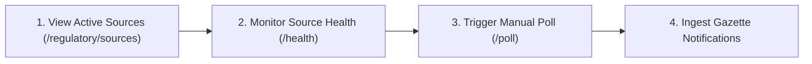
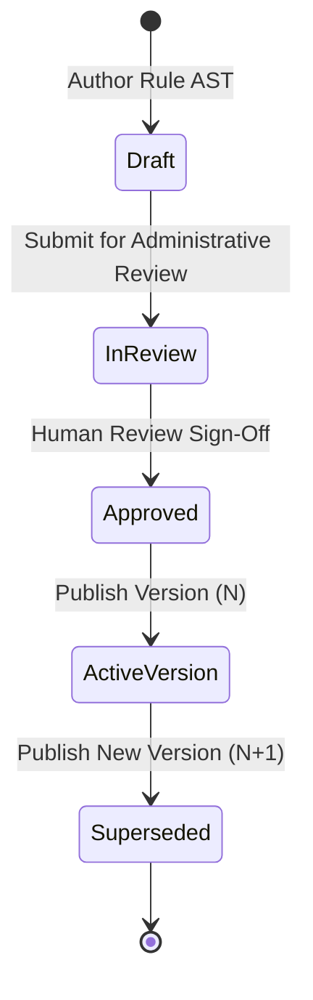

# PlantProof: Administrator Guide & Governance Operations

**System Version:** v1.0.0  
**Target Roles:** Platform Super Administrators (`SUPER_ADMIN`) and Enterprise Facility Administrators (`ADMIN`)  
**Scope:** Regulatory Source Management, Statutory Rule Governance, Version Publication, Team Member Administration, and Audit Trails  
**Status:** Grounded in Active System Implementation  

---

## 1. Administrative Overview & Role Boundaries

PlantProof provides comprehensive administrative capabilities to manage statutory reference catalogs, monitor official government feeds, publish legal rule versions, and govern multi-tenant user access.

### 1.1 Administrative Hierarchy
- **Platform Super Administrator (`SUPER_ADMIN`):**
  - Manages official government sources and web scraping adapters.
  - Reviews proposed legal amendments and publishes canonical statutory applicability rules.
  - Provisions enterprise tenants and other Super Administrator accounts.
- **Enterprise Facility Administrator (`ADMIN`):**
  - Manages plant facilities and equipment registries for their organization.
  - Invites plant managers, EHS officers, and compliance auditors to their tenant.
  - Reviews and signs off on facility-specific regulatory change impacts.
  - Strictly prohibited from provisioning `SUPER_ADMIN` accounts or modifying global statutory rules.

---

## 2. Regulatory Source Management (`/api/v1/regulatory/sources`)

PlantProof interfaces with central and state official depositories to ingest gazette notifications and statutory circulars.



### 2.1 Inspecting Active Sources
Navigate to **Admin $\rightarrow$ Regulatory Sources** or query `GET /api/v1/regulatory/sources` to view registered government adapters:
- `IN-EGAZETTE`: The Gazette of India (Daily Part II Section 3 notifications).
- `MH-MPCB`: Maharashtra Pollution Control Board circulars and guidelines.
- `IN-CPCB`: Central Pollution Control Board national standards.
- `MH-DISH`: Directorate of Industrial Safety & Health (Maharashtra Factories Act & Boilers).
- `IN-MOEFCC`: Ministry of Environment, Forest & Climate Change notifications.
- `LOCAL-FIXTURE`: Offline test bench vault for local validation.

### 2.2 Monitoring Source Health & Uptime
To check adapter responsiveness, call `GET /api/v1/regulatory/sources/{source_id}/health`:
```json
{
  "source_id": "src-mpcb-01",
  "status": "HEALTHY",
  "last_poll_at": "2026-10-24T02:00:00Z",
  "last_successful_ingestion": "2026-10-24T02:00:00Z",
  "consecutive_failures": 0,
  "last_http_status": 200,
  "error_message": null
}
```
If a government portal undergoes unannounced downtime or changes its layout, status transitions to `DEGRADED`. The system automatically limits retries to prevent connection storms.

### 2.3 On-Demand Source Ingestion
To force an immediate check of an official government portal outside scheduled intervals:
```http
POST /api/v1/regulatory/sources/{source_id}/poll
Authorization: Bearer <super_admin_jwt>
```
The scraper retrieves new notifications, applies cryptographic SHA-256 deduplication, and routes new circulars to the regulatory change review inbox.

---

## 3. Statutory Rule Governance & Version Publication (`/api/v1/admin/rules`)

In accordance with the **Cardinal Regulatory Rule ("AI Proposes, Humans Dispose")**, applicability rules are deterministic boolean logic trees that must be authored and published through an explicit review lifecycle.



### 3.1 Authoring a Statutory Rule AST
Statutory rules evaluate plant profile parameters using transparent boolean Abstract Syntax Trees (AST):
```json
{
  "statutory_requirement_code": "BOILER-INSP-CERT",
  "rule_version": 1,
  "expression_ast": {
    "and": [
      {"field": "jurisdiction", "operator": "==", "value": "Maharashtra"},
      {"field": "boiler_count", "operator": ">", "value": 0}
    ]
  },
  "pass_explanation_template": "Facility operates {boiler_count} steam boiler(s) in Maharashtra, triggering mandatory annual boiler inspection under the Indian Boilers Act, 1923.",
  "fail_explanation_template": "Facility has 0 registered steam boilers in operational master data."
}
```

### 3.2 Candidate Rule Approval (`POST /api/v1/admin/rules/{id}/approve`)
When a regulatory update proposes a new rule draft, an administrator reviews the AST logic, verifies statutory citations against the official gazette PDF, and approves the rule into the active catalog:
```http
POST /api/v1/admin/rules/{rule_id}/approve
Authorization: Bearer <super_admin_jwt>
```

### 3.3 Publishing Immutable New Rule Versions (`POST /api/v1/admin/rules/{id}/supersede`)
*Rules are never mutated in place.* When a statutory amendment alters an operational threshold (e.g., hazardous waste storage changing from 90 to 180 days):
```http
POST /api/v1/admin/rules/{rule_id}/supersede
Authorization: Bearer <super_admin_jwt>
Content-Type: application/json

{
  "new_expression_ast": { ... },
  "pass_explanation_template": "Updated threshold per MPCB Circular 2026...",
  "fail_explanation_template": "...",
  "change_rationale": "Superseding Rule v1 to reflect S.O. 4512(E) published in Gazette of India."
}
```
1. The previous rule version ($N$) is marked `superseded_by_rule_id = new_rule_id`.
2. The new rule version ($N+1$) is activated.
3. Historical evaluation records remain pinned to version $N$, preserving audit fidelity for past inspections.

---

## 4. User Provisioning & Role Management (`/api/v1/auth/users`)

PlantProof enforces server-side Role-Based Access Control (RBAC).

### 4.1 Inviting Team Members
Facility Administrators (`ADMIN`) or Super Administrators (`SUPER_ADMIN`) can provision team members:
```http
POST /api/v1/auth/users/invite
Authorization: Bearer <admin_jwt>
Content-Type: application/json

{
  "email": "neha.kulkarni@acme-mfg.in",
  "full_name": "Neha Kulkarni",
  "role": "EHS_MANAGER",
  "plant_ids": ["3ab69b24-77f8-42ee-a1c3-65d666bedd4d"]
}
```

### 4.2 Built-in Role Permissions Matrix

| Permission / Action | SUPER_ADMIN | ADMIN | PLANT_MANAGER | EHS_MANAGER | AUDITOR | VIEWER |
| :--- | :---: | :---: | :---: | :---: | :---: | :---: |
| **Manage Sources & Polling** | Yes | No | No | No | No | No |
| **Publish Statutory Rules** | Yes | No | No | No | No | No |
| **Invite Users to Tenant** | Yes | Yes | No | No | No | No |
| **Create/Edit Facilities** | Yes | Yes | Yes | No | No | No |
| **Upload Evidence Documents** | Yes | Yes | Yes | Yes | No | No |
| **Review & Approve Documents**| Yes | Yes | Yes | Yes | No | No |
| **Sign Off on Regulatory Impact**| Yes | Yes | Yes | No | No | No |
| **Assign Remediation Tasks** | Yes | Yes | Yes | Yes | No | No |
| **Export Readiness Dossiers** | Yes | Yes | Yes | Yes | Yes | No |
| **View Immutable Audit Logs** | Yes | Yes | No | No | Yes | No |
| **Read-Only Dashboard & Table**| Yes | Yes | Yes | Yes | Yes | Yes |

### 4.3 Security & Anti-Escalation Safeguards
1. **Privilege Escalation Prevention:** A tenant `ADMIN` cannot assign the `SUPER_ADMIN` role. Attempting to do so returns `HTTP 403 Forbidden`.
2. **Cross-Tenant Collision Protection:** Attempting to invite an email address that already belongs to another organization returns `HTTP 409 Conflict`.
3. **Role Gating:** The invitation endpoint strictly rejects read-only `VIEWER`, `AUDITOR`, and `EHS_MANAGER` callers.

---

## 5. System Audit Trail & Security Ledger (`/api/v1/admin/audit-logs`)

PlantProof records every state mutation, user override, and approval event in an append-only audit ledger:
- **Query Endpoint:** `GET /api/v1/admin/audit-logs?action=APPROVE_DOCUMENT&page=1&page_size=20`
- **Access Control:** Restricted to `SUPER_ADMIN`, `ADMIN`, and `AUDITOR` roles (`HTTP 403` for others).

### 5.1 Sample Audit Event
```json
{
  "id": "aud-89342718",
  "timestamp": "2026-10-24T04:50:13.569Z",
  "user_id": "user-amit-admin",
  "user_name": "Amit Jadhav",
  "user_email": "amit.jadhav@acme-mfg.in",
  "action": "DOCUMENT_APPROVED",
  "entity_type": "ComplianceDocument",
  "entity_id": "doc-boiler-cert-01",
  "description": "Amit Jadhav approved Boiler Inspection Certificate for facility 'Pune Manufacturing Unit 1'.",
  "previous_state": {
    "review_status": "PENDING_REVIEW",
    "verified_expiry_date": null
  },
  "new_state": {
    "review_status": "APPROVED",
    "verified_expiry_date": "2026-11-14"
  },
  "ip_address": "192.168.1.45"
}
```

### 5.2 Tamper Evident Guarantee
- Direct database `UPDATE` and `DELETE` queries on `audit_logs` are prevented at the ORM layer.
- All timestamps are recorded in UTC with ISO 8601 formatting.
- Client IP addresses and correlation IDs link every audit event back to the original HTTP transaction.
