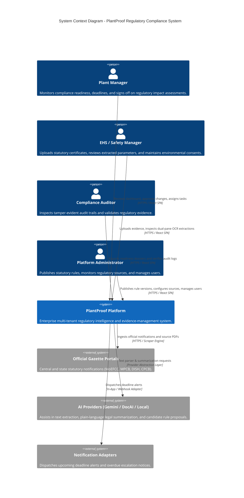
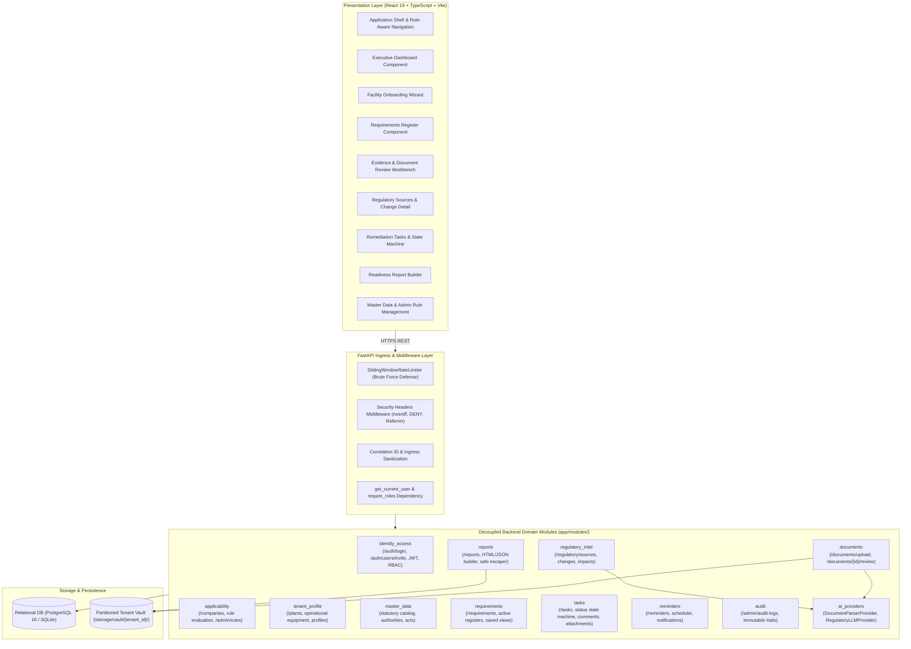

# PlantProof: System Architecture & Technical Specification

**System Version:** v1.0.0  
**Pattern:** Modular Monolith with Decoupled Domain Boundaries  
**Target Runtime:** Python 3.11 / 3.13 + FastAPI + React 19 SPA  
**Document Status:** Grounded in Actual Codebase Implementation  

---

## 1. Architectural Strategy: The Modular Monolith

PlantProof is engineered as a **Modular Monolith** organized into distinct domain packages under `app/modules/`.

### 1.1 Architectural Rationale
- **High Domain Cohesion:** In manufacturing compliance, statutory requirements, evidence documents, remediation tasks, and readiness reporting share immediate transactional boundaries (e.g., approving an evidence certificate updates requirement evidence status, resolves open deficiency tasks, recalculates readiness score, and emits an immutable audit event).
- **Elimination of Distributed Overhead:** Avoids distributed transactions (2PC/Saga), network latency, RPC retries, and cross-service eventual consistency pitfalls.
- **Strict Boundary Enforcement:** Domain logic is partitioned into 12 decoupled modules with explicit Pydantic DTOs, typed service interfaces, and router controllers.
- **Zero-Dependency Local Testing:** Designed with provider abstraction patterns allowing local heuristic execution without mandatory cloud infrastructure.

---

## 2. Mermaid Architecture Diagrams

### 2.1 System Context Diagram (C4 Level 1)

---

### 2.2 Component Diagram (C4 Level 2 / Modular Monolith)

---

## 3. Current Module Inventory & Responsibilities

The PlantProof backend codebase is partitioned into 12 cohesive modules within `app/modules/`:

| Module Directory | Primary Responsibility | Primary Router Prefix | Key Exported Services / Schemas |
| :--- | :--- | :--- | :--- |
| **`identity_access`** | User authentication, password hashing (bcrypt), JWT generation, RBAC role gating, and team member invitations. | `/api/v1/auth` | `auth_service`, `TokenResponse`, `UserListItem` |
| **`tenant_profile`** | Plant facility master records, physical equipment inventories (boilers, DG sets, ETP), and operational capacities. | `/api/v1/plants` | `plant_service`, `PlantProfileResponse`, `EquipmentCreate` |
| **`applicability`** | Facility creation (`/companies`), operational profile reassessment simulation, and deterministic boolean rule AST evaluation. | `/api/v1/companies`, `/api/v1/admin/rules` | `applicability_engine`, `ApplicabilityAssessment` |
| **`master_data`** | Canonical statutory master data (Acts, Authorities, Jurisdictions, Industry Categories, Standard Document Types). | `/api/v1/master-data` | `master_data_service`, `StatutoryAct`, `Authority` |
| **`requirements`** | Active statutory requirements register, server-side pagination, faceted filters, saved views, and provenance details. | `/api/v1/requirements` | `requirements_service`, `PaginatedRequirementsResponse` |
| **`documents`** | Evidence vault ingestion, cryptographic SHA-256 deduplication, parameter extraction, and human review workbench. | `/api/v1/documents` | `document_service`, `DocumentUploadResponse`, `ReviewWorkbench` |
| **`regulatory_intel`** | Official gazette notice ingestion, plain-language summaries, automated plant profile impact assessment, and review. | `/api/v1/regulatory` | `regulatory_intel_service`, `SourceHealth`, `ChangeImpact` |
| **`tasks`** | Compliance remediation task lifecycle, state machine transitions (`TODO` $\rightarrow$ `IN_PROGRESS` $\rightarrow$ `BLOCKED` $\rightarrow$ `COMPLETED`), comments, attachments. | `/api/v1/tasks` | `task_service`, `TaskDetailResponse`, `TaskStatusTransition` |
| **`reminders`** | Multi-channel reminder scheduler, due-soon and overdue item identification, alert preferences, and test dispatch adapters. | `/api/v1/reminders` | `reminder_service`, `NotificationResponse`, `RunSchedulerResult` |
| **`reports`** | Executive audit readiness report builder, readiness score calculation, and XSS-safe HTML/JSON dossier generation. | `/api/v1/reports` | `readiness_report_service`, `ReportJobResponse` |
| **`audit`** | System-wide immutable audit trail logging with actor details, action codes, previous/new state diffs, and human descriptions. | `/api/v1/admin/audit-logs`| `audit_service`, `AuditLogEntryResponse` |
| **`ai_providers`** | Abstract base interfaces and concrete adapters for document parsing and regulatory legal text processing. | Internal Provider Layer | `DocumentParserProvider`, `RegulatoryLLMProvider` |

---

## 4. Cross-Module Communication & Dependency Rules

1. **Unidirectional Dependency Flow:** Upstream modules (e.g., `master_data`, `tenant_profile`) never import or call downstream workflows (`reports`, `reminders`).
2. **Explicit Service Invocations:** When a domain event occurs (such as approving a document in `documents`), the review service directly invokes the `requirements_service` to link evidence, updates the task state in `tasks`, and records the audit record in `audit`.
3. **Tenant & Role Context Propagation:** Every service method accepts a `user: User` parameter carrying verified claims (`tenant_id`, `role`, `plant_ids`), enforcing authorization at the domain boundary.
4. **Structured Error Envelopes:** All service exceptions inherit from `AppException` and map to standard HTTP status codes with machine-readable error codes and remediation guidance.
