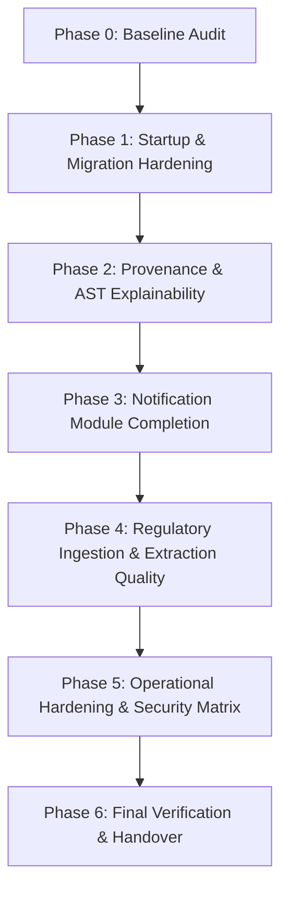

# PlantProof Implementation Gap Audit & Baseline Analysis

**Document Status:** Complete & Verified Against Source Code  
**Date of Audit:** October 28, 2026  
**Auditor:** PlantProof Enterprise Pair Programming Agent  
**Target Codebase:** `d:\Complaince System`  

---

## Executive Summary

This audit establishes a factual, code-grounded baseline for **PlantProof** before applying changes in subsequent phases. Every finding below has been verified against active source code, configuration files, test suites, and database migration histories in this checkout. No claims from `README.md` or design documentation were accepted without source confirmation.

**Key Baseline Facts:**
- **Backend Test Suite:** 105 tests collected and passing via `.\venv\Scripts\pytest` (README claims 97).
- **Frontend Test Suite:** 11 tests in 4 test files passing via `npm test` (Vitest).
- **Frontend Build & Lint:** `npm run build` succeeds (1.27s); `npm run lint` completes with 0 errors and 20 warnings (Oxlint).
- **Database Migrations:** 6 linear Alembic revisions ending at head `921912ca7670`. `alembic check` reports zero model drift against current SQLAlchemy 2.0 declarative models.
- **Module Architecture:** A reminder and notification subsystem already exists in `app/modules/reminders` with models `ReminderNotification` and `UserNotificationPreference`. It must be extended, **never duplicated**.

---

## 1. Confirmed Existing Behavior vs. Documentation Claims

### 1.1 Startup, Lifecycle & Schema Initialization
- **Active Code (`app/main.py:26-45`):**
  - Startup lifespan unconditionally calls `Base.metadata.create_all(bind=engine)` on line 31 regardless of environment (`ENVIRONMENT="development"`, `"test"`, or `"production"`).
  - Startup lifespan unconditionally calls `seed_demo_data(db)` on line 36.
  - **Seed Failure Swallowing (`app/main.py:38-39`):** The startup lifespan wraps `seed_demo_data(db)` in `try...except Exception as exc:` and executes `logger.error(f"Error during master data seed initialization: {exc}", exc_info=True)`. The exception is caught and swallowed; the application continues running in a partially initialized or unseeded state without failing fast.
- **Documentation Discrepancy:** `README.md:108-115` implies schema creation is strictly driven by `alembic upgrade head` and demo data by `python -m app.cli seed-demo-data`. In reality, simply booting `uvicorn app.main:app` creates all tables and provisions demo users automatically.

### 1.2 Configuration & Secret Key Security
- **Active Code (`app/core/config.py:18-22`, `.env.example:18`):**
  - Default `SECRET_KEY` in `Settings` is `"demo-insecure-secret-key-change-in-production-plantproof-compliance"`.
  - `.env.example` provides `"demo-fake-secret-key-do-not-use-in-production-plantproof-auth"`.
  - There is **no validation** in `Settings` or startup hooks verifying that `ENVIRONMENT != "development"` rejects placeholder keys or enforces `DEBUG=False`. An operator can set `ENVIRONMENT="production"` while retaining the hardcoded demo secret key and `DEBUG=True`.
- **Redis Configuration (`app/core/config.py:37-38`, `.env.example:41-42`):**
  - `REDIS_ENABLED` and `REDIS_URL` are defined in `Settings`, but a codebase-wide grep confirms `REDIS_ENABLED` is referenced **nowhere else** in the backend. There is no Redis connection pool, cache layer, or Celery/ARQ worker in the repository.

### 1.3 Rate Limiting Implementation
- **Active Code (`app/core/rate_limit.py:12-98`):**
  - `SlidingWindowRateLimiter` is an in-memory dictionary (`self._records: Dict[str, List[float]]`) guarded by a standard Python `threading.Lock()`.
  - It tracks request timestamps per client IP.
  - **Limitation:** It is strictly process-local. If multiple Uvicorn worker processes are spawned, rate limits are not shared across processes.
  - **Code Defect (`app/core/rate_limit.py:87-90`):** The comment claims *"If user is authenticated, include tenant/user if available"*, but the code merely sets `limit_key = f"{key_prefix}:{client_ip}"`, ignoring `auth_header`.

### 1.4 Background Scheduling & Worker Durability
- **Active Code (`app/modules/reminders/router.py:65-74`, `app/modules/reports/router.py:58-62`):**
  - There is **no background daemon, cron worker, or periodic timer** running in the application process.
  - Reminder scanning occurs **only on-demand** when an authenticated user sends `POST /api/v1/reminders/run-scheduler`.
  - Reports use FastAPI's in-process `BackgroundTasks` when `run_async=True`.

### 1.5 Confirmed Active Endpoints Catalog
All 72 endpoints registered in `app/api/v1/router.py`:
- **Health & Diagnostics (`app/api/v1/health.py`):**
  - `GET /api/v1/health`
  - `GET /api/v1/health/system-info`
  - `GET /api/v1/health/diagnostics`
- **Identity & Access (`app/modules/identity_access/router.py`):**
  - `POST /api/v1/auth/token`
  - `POST /api/v1/auth/refresh`
  - `GET /api/v1/auth/me`
  - `POST /api/v1/auth/invite`
  - `POST /api/v1/auth/accept-invite`
  - `POST /api/v1/auth/reset-password`
- **Plants & Operational Profile (`app/modules/tenant_profile/router.py`):**
  - `GET /api/v1/plants`
  - `POST /api/v1/plants`
  - `GET /api/v1/plants/{plant_id}`
  - `GET /api/v1/plants/{plant_id}/profile`
  - `PUT /api/v1/plants/{plant_id}/profile`
  - `GET /api/v1/plants/{plant_id}/equipment`
  - `POST /api/v1/plants/{plant_id}/equipment`
  - `DELETE /api/v1/plants/{plant_id}/equipment/{equipment_id}`
- **Master Data (`app/modules/master_data/router.py`):**
  - `GET /api/v1/master-data/jurisdictions`
  - `GET /api/v1/master-data/industry-categories`
  - `GET /api/v1/master-data/regulatory-authorities`
  - `GET /api/v1/master-data/document-types`
  - `GET /api/v1/master-data/business-activities`
  - `GET /api/v1/master-data/regulations`
  - `GET /api/v1/master-data/requirements`
  - `GET /api/v1/master-data/sources`
- **Applicability & Assessments (`app/modules/applicability/router.py`):**
  - `POST /api/v1/companies/{plant_id}/assessments`
  - `GET /api/v1/companies/{plant_id}/assessments`
  - `GET /api/v1/companies/{plant_id}/assessments/{assessment_id}`
  - `GET /api/v1/companies/{plant_id}/proposed-changes`
  - `POST /api/v1/companies/{plant_id}/proposed-changes/{change_id}/review`
- **Admin Applicability Rules (`app/modules/applicability/admin_router.py`):**
  - `GET /api/v1/admin/rules/requirements/{requirement_id}/versions`
  - `POST /api/v1/admin/rules/requirements/{requirement_id}/versions`
  - `POST /api/v1/admin/rules/{rule_id}/approve`
  - `POST /api/v1/admin/rules/{rule_id}/reject`
  - `POST /api/v1/admin/rules/preview-evaluation`
- **Regulatory Intelligence (`app/modules/regulatory_intel/router.py`):**
  - `POST /api/v1/regulatory/sources/poll-now`
  - `GET /api/v1/regulatory/sources`
  - `GET /api/v1/regulatory/sources/{source_id}/health`
  - `GET /api/v1/regulatory/changes`
  - `GET /api/v1/regulatory/changes/{change_id}`
  - `POST /api/v1/regulatory/changes/{change_id}/approve`
  - `POST /api/v1/regulatory/changes/{change_id}/reject`
  - `GET /api/v1/regulatory/changes/{change_id}/impacts`
- **Document Vault (`app/modules/documents/router.py`):**
  - `POST /api/v1/documents/upload`
  - `GET /api/v1/documents`
  - `GET /api/v1/documents/{document_id}`
  - `GET /api/v1/documents/{document_id}/file`
  - `POST /api/v1/documents/{document_id}/approve`
  - `POST /api/v1/documents/{document_id}/reject`
  - `POST /api/v1/documents/{document_id}/re-extract`
- **Requirements Register (`app/modules/requirements/router.py`):**
  - `GET /api/v1/requirements`
  - `GET /api/v1/requirements/{id}`
  - `GET /api/v1/requirements/saved-views`
  - `GET /api/v1/requirements/metrics/summary`
- **Compliance Tasks (`app/modules/tasks/router.py`):**
  - `GET /api/v1/tasks`
  - `POST /api/v1/tasks`
  - `GET /api/v1/tasks/{task_id}`
  - `PUT /api/v1/tasks/{task_id}`
  - `POST /api/v1/tasks/{task_id}/status`
  - `POST /api/v1/tasks/{task_id}/comments`
  - `POST /api/v1/tasks/{task_id}/attachments`
- **Reminders & Notifications (`app/modules/reminders/router.py`):**
  - `GET /api/v1/reminders/notifications`
  - `PATCH /api/v1/reminders/notifications/{notification_id}/read`
  - `POST /api/v1/reminders/notifications/read-all`
  - `POST /api/v1/reminders/run-scheduler`
  - `GET /api/v1/reminders/preferences`
  - `PUT /api/v1/reminders/preferences`
  - `POST /api/v1/reminders/test-notification`
- **Readiness Reports (`app/modules/reports/router.py`):**
  - `GET /api/v1/reports`
  - `POST /api/v1/reports`
  - `GET /api/v1/reports/{job_id}`
  - `GET /api/v1/reports/{job_id}/download`
- **Audit Logs (`app/modules/audit/router.py`):**
  - `GET /api/v1/audit/logs`
  - `GET /api/v1/audit/summary`

---

## 2. Existing Notification/Reminder Capabilities & Gaps

### 2.1 Confirmed Existing Implementation
1. **Database Models (`app/models/reminders.py`):**
   - `ReminderNotification`: `id`, `tenant_id`, `plant_id`, `user_id`, `notification_type` (`DUE_SOON`, `OVERDUE`, `STATUS_CHANGE`), `entity_type` (`REQUIREMENT`, `TASK`), `entity_id`, `title`, `message`, `channel` (`IN_APP`, `EMAIL`), `status` (`UNREAD`, `READ`, `DISMISSED`), `sent_at`, `read_at`, `dedup_key` (unique constraint `uq_reminder_dedup_key`), `metadata_payload`.
   - `UserNotificationPreference`: `id`, `tenant_id`, `user_id` (unique), `email_enabled`, `in_app_enabled`, `lead_time_days`, `notify_on_overdue`, `frequency`.
2. **Service Logic (`app/modules/reminders/services.py`):**
   - Deduplication key scheme: `{date}:{entity_type}:{entity_id}:{notification_type}:{channel}`.
   - Scans open compliance tasks (`status != "COMPLETED"`) for overdue and due soon.
   - Scans applicable plant requirements with `current_due_date` for overdue and expiring soon.
   - Dispatches in-app entries and delivers to in-memory `TestNotificationAdapter`.
3. **Frontend Integration (`frontend/src/components/layout/Header.tsx:388-610`):**
   - Bell icon with unread badge counter.
   - Dropdown showing notifications, unread styling, "Mark all read", "Scan Due-Soon Work", and "Send Test Alert".

### 2.2 What Is Genuinely Missing
1. **Schema & Model Fields:**
   - No `severity` field (`LOW`, `MEDIUM`, `HIGH`, `CRITICAL`).
   - No `action_route` field (relative internal URL e.g. `/tasks/{task_id}` or `/requirements`).
   - No `resource_type` / `resource_id` standardized naming (currently uses `entity_type` / `entity_id`).
   - `user_id` is named `user_id` instead of `recipient_user_id` (or mapped alias).
   - No `archived_at` field.
   - `user_notification_preferences` lacks granular per-event-type flags (e.g. `notify_task_assigned`, `notify_regulatory_change`).
2. **Missing Event Triggers:**
   - **Task Assigned:** When a task is created or reassigned to a user (`app/modules/tasks/services.py:65-72`), no notification is emitted.
   - **Document Expiry:** When uploaded documents/certificates in `compliance_documents` approach `valid_until` date, no notification is emitted.
   - **Regulatory Change Approved:** When a gazette notification or regulatory circular is approved and impacts facilities of a tenant (`app/modules/regulatory_intel/pipeline.py:440-490`), no notification is emitted to plant/EHS managers.
   - **Review Required:** When a document extraction or rule change is placed in `PENDING_REVIEW` or `UNDER_REVIEW`, no notification is emitted to assigned reviewers.
3. **API & Endpoint Gaps:**
   - No dedicated `GET /api/v1/reminders/unread-count` endpoint (unread count is currently coupled to the paginated list endpoint).
   - No filtering by `severity` or `event_type`.
   - No RBAC authorization on user preferences update (any authenticated user can update preferences, but administrative preferences endpoints do not exist).
4. **Operational & CLI Gaps:**
   - No CLI command exists in `app/cli.py` to trigger the reminder scan offline.
   - No `--dry-run` mode returning considered, created, skipped, and failed metrics without database persistence.
5. **Frontend UX Deficiencies:**
   - Notification item click (`Header.tsx:551`) marks the notification as read, but **does not navigate** to the related task or requirement.
   - Header uses blocking browser `alert()` popups (`Header.tsx:123-145`) when running scans or sending test notifications.
   - Notification polling is implemented using raw `setInterval` (`Header.tsx:64`) rather than the application's standard TanStack Query caching and invalidation pattern.
   - No dedicated user notification preferences screen or modal.

---

## 3. Concrete Defects vs. Design/Production Limitations

### 3.1 Concrete Defects (Bugs / Code Flaws)
1. **Intra-Tenant Notification IDOR (`app/modules/reminders/services.py:173`):**
   ```python
   notif = db.get(ReminderNotification, notification_id)
   if not notif or notif.tenant_id != user.tenant_id:
       raise EntityNotFoundError("ReminderNotification", notification_id)
   ```
   *Defect:* The authorization check only verifies `tenant_id == user.tenant_id`. It fails to verify that `notif.user_id == user.id` (or `notif.user_id is None`). Any user within a tenant can mark another user's personal notifications as read.
2. **Unhandled Concurrency Exception in Reminder Deduplication (`app/modules/reminders/services.py:275-295`):**
   *Defect:* The deduplication check runs `existing = db.scalar(select(...).where(dedup_key == key))`. If two concurrent requests invoke `/run-scheduler`, both pass the select check and attempt `db.add()`. One commits while the other triggers an unhandled `IntegrityError` on `uq_reminder_dedup_key`, generating an HTTP 500 internal server error.
3. **Rule Evaluator Type Mismatch Treats Unknown as Non-Applicable (`app/modules/applicability/engine.py:369-370`):**
   ```python
   except (ValueError, TypeError):
       return False
   ```
   *Defect:* When evaluating leaf conditions, if a fact has an incompatible type (e.g. string `"high"` compared with `> 10`), `_compare` catches the error and returns `False` (`EvalResult.FALSE`). Under Kleene three-valued logic, `FALSE AND anything` evaluates to `FALSE` (`NOT_APPLICABLE`). An invalid fact type thus declares an obligation legally **non-applicable** instead of flagging `UNKNOWN` (`NEEDS_REVIEW`).
4. **Startup Exception Swallowing (`app/main.py:38-39`):**
   *Defect:* `seed_demo_data` failures are caught and logged with no exit or startup termination. If master regulatory tables fail to seed, the application starts with empty catalogs, causing downstream 500 errors on onboarding and assessments.
5. **Hardcoded Demo Credentials Injected on Production Boot (`app/main.py:36`, `app/seed/demo_data.py:264-285`):**
   *Defect:* `seed_demo_data` creates demo personas with password `DemoPass123!` whenever `Tenant.code == "acme-mfg"` is absent. This executes on every startup, regardless of environment.

### 3.2 Design & Production Limitations (Intentional Constraints)
1. **Local In-Memory Rate Limiter:** The sliding-window rate limiter in `app/core/rate_limit.py` is designed for single-process local development. It is not distributed and does not support multi-instance cluster coordination.
2. **Local Heuristic / Synthetic Document AI:** Document parameter extraction in `app/modules/documents/ai_service.py` (`MockSyntheticDocumentAIProvider`) uses heuristic regex pattern matching and synthetic PDF templates rather than live OCR APIs (Google Cloud Document AI / Gemini Vision).
3. **Local Regulatory Feed:** Ingestion in `app/modules/regulatory_intel/adapters/fixture_adapter.py` operates on deterministic synthetic circulars rather than live web scrapers with CAPTCHA solvers.
4. **Local Vault Storage:** Files are stored in `./storage/vault/{tenant_id}/` using local filesystem APIs (`app/modules/documents/storage.py`), not an S3/GCS object bucket.

---

## 4. Risks Ranked P0 / P1 / P2

| Priority | ID | Description | Impact | Target Phase |
| :---: | :---: | :--- | :--- | :---: |
| **P0** | **SEC-01** | Production boot allows default/placeholder JWT `SECRET_KEY` and `DEBUG=True`. | Complete compromise of JWT authentication and session forgery. | Prompt 1 |
| **P0** | **SEC-02** | Unconditional seeding injects demo users with `DemoPass123!` into production databases. | Unauthorized backdoor into production multi-tenant environments. | Prompt 1 |
| **P0** | **SEC-03** | `Base.metadata.create_all()` called unconditionally on startup, bypassing Alembic. | Schema drift, unmanaged DDL in production, failure to track database revisions. | Prompt 1 |
| **P0** | **REG-01** | Type mismatch in AST rule engine returns `FALSE` (`NOT_APPLICABLE`) instead of `UNKNOWN` (`NEEDS_REVIEW`). | False negative regulatory declaration; enterprise unlawfully skips mandatory consent/licence. | Prompt 2 |
| **P1** | **NOT-01** | Notification recipient authorization flaw allows cross-user mutation within same tenant. | Violation of user privacy and audit integrity. | Prompt 3 |
| **P1** | **NOT-02** | Race condition on concurrent reminder scheduler runs crashes with unhandled 500 `IntegrityError`. | Service disruption on overlapping scheduler triggers. | Prompt 3 |
| **P1** | **NOT-03** | Missing notification triggers for task assignment, document expiry, and approved regulatory changes. | Compliance officers miss imminent statutory deadlines and circular updates. | Prompt 3 |
| **P1** | **REG-02** | Applicability rules lack separate `publication_date` and stored source file fingerprint. | Regulatory provenance cannot prove gazette notification date vs effective enforcement date. | Prompt 2 |
| **P1** | **OPS-01** | Startup catches and swallows seed failures; partial initialization undetected. | System runs with corrupted or missing global reference catalogs. | Prompt 1 |
| **P2** | **UX-01** | Notification bell dropdown uses blocking browser `alert()` and unlinked items. | Degraded user experience and broken click-through to affected resources. | Prompt 3 |
| **P2** | **OPS-02** | Inactive `REDIS_ENABLED` configuration in `.env.example` and `config.py`. | Operator confusion regarding infrastructure dependencies. | Prompt 1 & 5 |
| **P2** | **DOC-01** | Class name discrepancies between README documentation and active source code. | Developer confusion during maintenance. | Prompt 6 |

---

## 5. Minimal Implementation Plan

To avoid creating duplicate modules and prevent breaking existing working behavior, the implementation must proceed in the following strict order:



### Phase 1: Startup Configuration, Schema Migrations & Seeding (Prompt 1)
- **Files to Modify:** `app/core/config.py`, `app/main.py`, `app/cli.py`, `app/seed/demo_data.py`.
- **Changes:**
  1. Add Pydantic validator on `Settings` to reject known placeholder secret keys and `DEBUG=True` when `ENVIRONMENT in ("production", "staging")`.
  2. Restrict `Base.metadata.create_all()` in `app/main.py` so it only executes when `ENVIRONMENT in ("development", "test")` AND an explicit setting or empty SQLite database is detected. In production, require Alembic migrations.
  3. Modify `app/main.py` and `app/seed/demo_data.py`: only seed demo personas (`acme-mfg`, `beta-pharma`) when `ENVIRONMENT == "development"` or an explicit flag (`SEED_DEMO_USERS=true`) is active. Never inject demo credentials into production.
  4. Ensure initialization failures in production fail fast by raising an exception rather than catching and continuing.
  5. Add test coverage in `tests/unit/test_security.py` verifying development convenience vs. production refusal of placeholder secrets.

### Phase 2: Compliance Provenance & Explainable Applicability Results (Prompt 2)
- **Files to Modify:** `app/models/catalog.py`, `app/modules/applicability/engine.py`, `app/modules/applicability/services.py`, `app/modules/applicability/schemas.py`, `alembic/versions/`.
- **Changes:**
  1. Add Alembic migration adding separate `publication_date`, `instrument_identifier`, `clause_reference`, `source_url`, and `source_hash` to `applicability_rules`.
  2. Update `ApplicabilityEngine._compare`: on `(ValueError, TypeError)`, return `EvalResult.UNKNOWN` and add field to `missing_facts` so type mismatches produce `NEEDS_REVIEW` rather than `NOT_APPLICABLE`.
  3. Add AST unit test edge cases in `tests/unit/test_applicability_engine.py` for empty groups, nested conditions, missing facts, and type mismatches.
  4. Update frontend `RequirementsPage.tsx` and requirement detail components to render the "Why this result?" breakdown and visual distinction for `NEEDS_REVIEW`.

### Phase 3: Notification Module End-to-End (Prompt 3)
- **Files to Modify:** `app/models/reminders.py`, `app/modules/reminders/schemas.py`, `app/modules/reminders/services.py`, `app/modules/reminders/router.py`, `app/modules/tasks/services.py`, `app/modules/documents/services.py`, `app/modules/regulatory_intel/pipeline.py`, `app/cli.py`, `frontend/src/components/layout/Header.tsx`, `frontend/src/services/api.ts`.
- **Changes:**
  1. **Extend Existing Module:** Reuse `app/modules/reminders` without creating a duplicate notification package.
  2. Add Alembic migration adding `severity`, `action_route`, `archived_at` to `reminder_notifications`, and per-event notification toggles to `user_notification_preferences`.
  3. Fix recipient isolation in `ReminderService.mark_as_read` to enforce `notif.user_id == user.id or notif.user_id is None`.
  4. Implement domain event triggers for:
     - Task assigned (`TASK_ASSIGNED`).
     - Document validity expiring (`DOCUMENT_EXPIRING`).
     - Approved regulatory circular matching plant (`REGULATORY_CHANGE_APPROVED`).
  5. Add standalone `GET /api/v1/reminders/unread-count` endpoint.
  6. Add CLI command `python -m app.cli run-reminders [--dry-run]` in `app/cli.py`.
  7. Update frontend `Header.tsx`: replace `alert()` with non-blocking UI, add click-through navigation using `action_route`, and switch from raw `setInterval` to TanStack Query invalidation.

### Phase 4: Regulatory Ingestion & Document Extraction (Prompt 4)
- **Files to Modify:** `app/modules/regulatory_intel/`, `app/modules/documents/`, `tests/evaluation/test_extraction_quality.py`, `docs/KNOWN_LIMITATIONS.md`.
- **Changes:**
  1. Clearly label adapter modes in API responses and UI: `FIXTURE`, `LIVE_HTTP`, `DISABLED`, or `FAILED`.
  2. Surface source health, last attempt, and sanitised error category without leaking internal stack traces.
  3. Keep the deterministic evaluation benchmark in `tests/evaluation/test_extraction_quality.py` passing with genuine measured metrics (Precision, Recall, F1 $\ge 0.95$).

### Phase 5: Operational Readiness & Security Hardening (Prompt 5)
- **Files to Modify:** `app/core/rate_limit.py`, `app/core/logging.py`, `tests/integration/test_security_hardening.py`.
- **Changes:**
  1. Formalize rate limiter interface (`BaseRateLimiter`) with in-memory implementation for tests/demos. Document single-process limitation.
  2. Ensure correlation IDs are attached to all structured logs and API responses.
  3. Add comprehensive RBAC matrix tests covering all roles (`ADMIN`, `PLANT_MANAGER`, `EHS_MANAGER`, `VIEWER`, `AUDITOR`) across all protected actions.

### Phase 6: Final Verification & Handover (Prompt 6)
- **Files to Modify:** `docs/IMPLEMENTATION_HANDOVER.md`, `README.md`.
- **Changes:**
  1. Execute all test suites (backend pytest, frontend vitest, oxlint, vite build, alembic upgrade).
  2. Document all added configuration, migration commands, and manual smoke test checklist.

---

## 6. Exact Tests & Build Commands in Current Checkout

The following commands have been tested and verified in this environment:

### Backend Commands (PowerShell)
```powershell
# Activate virtual environment
.\venv\Scripts\Activate.ps1

# Run complete backend test suite (105 tests)
.\venv\Scripts\pytest -v

# Run targeted test suites
.\venv\Scripts\pytest tests/unit/test_migrations.py -v
.\venv\Scripts\pytest tests/unit/test_applicability_engine.py -v
.\venv\Scripts\pytest tests/unit/test_security.py -v
.\venv\Scripts\pytest tests/integration/test_security_hardening.py -v
.\venv\Scripts\pytest tests/integration/test_tenant_safety.py -v
.\venv\Scripts\pytest tests/integration/test_operational_workflows.py -v
.\venv\Scripts\pytest tests/evaluation/test_extraction_quality.py -v

# Database schema management (Alembic)
.\venv\Scripts\alembic history --verbose
.\venv\Scripts\alembic current
.\venv\Scripts\alembic check
.\venv\Scripts\alembic upgrade head

# CLI database initialization and seeding
python -m app.cli init-db
python -m app.cli seed-demo-data

# Start local backend API server
uvicorn app.main:app --reload --port 8000
```

### Frontend Commands (`frontend/` directory)
```powershell
cd frontend

# Run frontend test suite (11 tests in 4 test files)
npm test

# Run frontend linting (Oxlint)
npm run lint

# Run TypeScript check and Vite production bundle build
npm run build

# Start local frontend development server
npm run dev
```

---

## Conclusion & Readiness

The PlantProof repository is in a healthy, test-passing baseline state. The architecture is cleanly partitioned into modular domains. The audit has exposed specific, remediable configuration vulnerabilities (P0), provenance gaps (P1), and notification subsystem limitations (P1) that will be methodically addressed in Prompts 1 through 6 according to the implementation order defined above.
