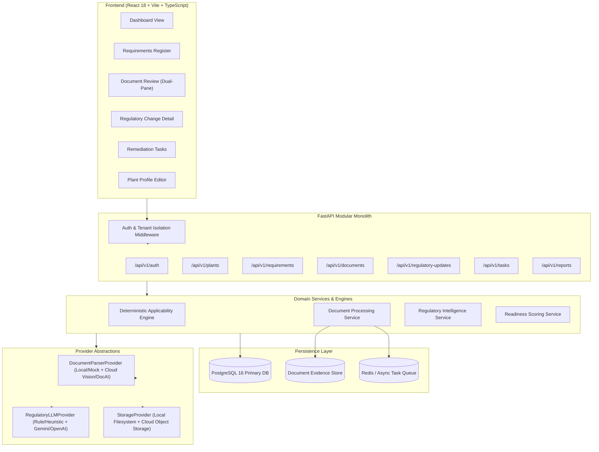
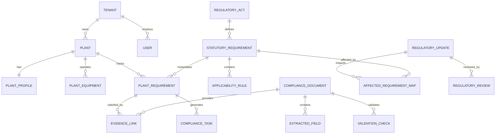
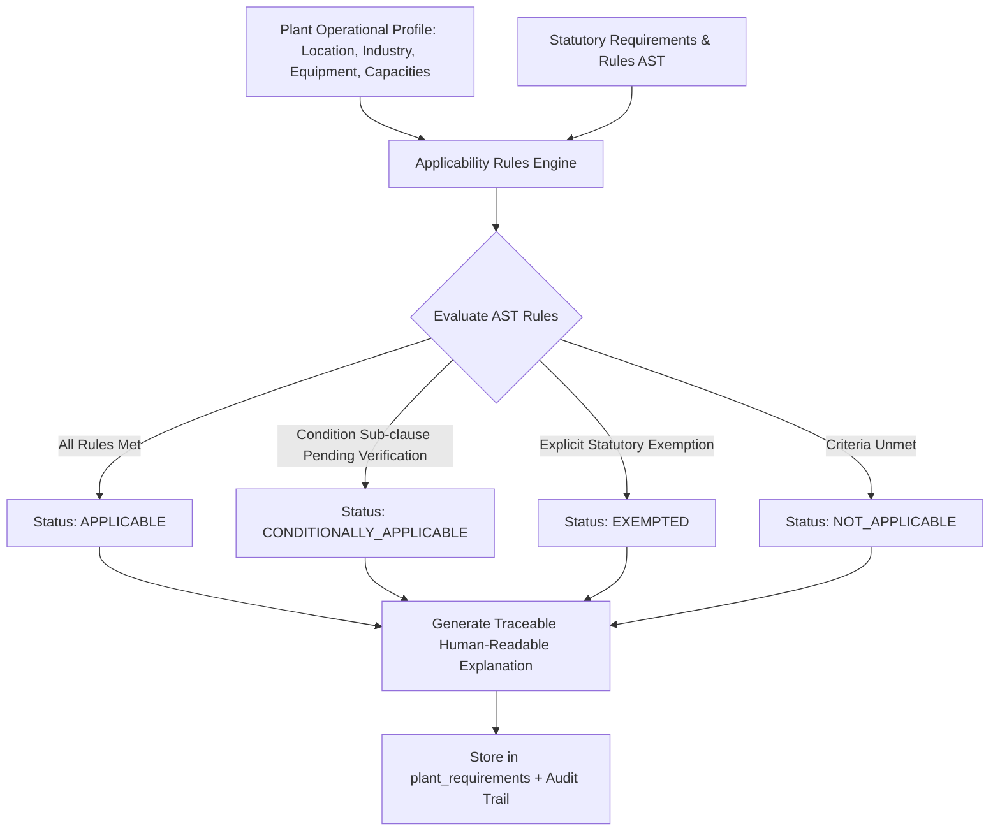
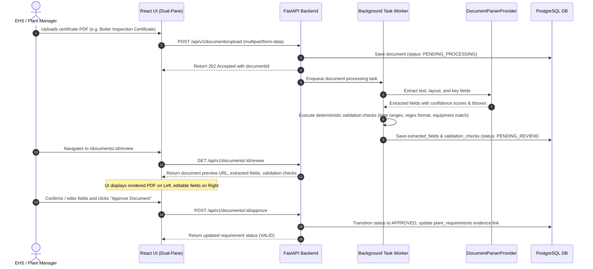
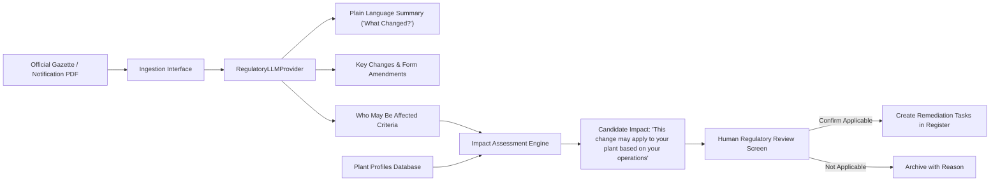
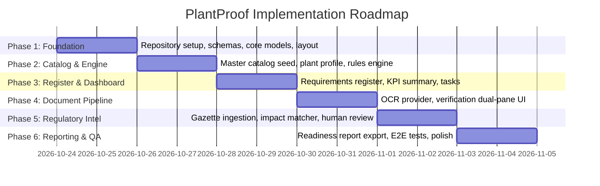

# PlantProof: Implementation Plan & Architectural Blueprint
**Document Version:** 1.0.0  
**Status:** Approved for Implementation Planning  
**Target Architecture:** Modular Monolith (Python 3.13 FastAPI + PostgreSQL 16 + React 18 / Vite / TypeScript)

---

## 1. Executive Summary & Product Vision

### 1.1 Product Mission
**PlantProof** is an enterprise multi-tenant regulatory intelligence and compliance-evidence application engineered for manufacturing companies operating in complex regulatory jurisdictions (with an initial focus on Indian Central and State manufacturing regulations including MPCB, DISH/Labour, MoEFCC, CPCB, PESO, ESIC, and Municipal Authorities).

Manufacturing enterprises struggle with:
1. **Fragmented statutory knowledge:** Dispersed acts, amendments, gazette notifications, and rules across dozens of regulatory bodies.
2. **Opaque applicability:** Uncertainty about which specific consents, licences, registrations, and inspection certificates apply to a specific factory unit based on manufacturing capacity, chemical inventories, boiler specs, or employee headcount.
3. **Fragile evidence registers:** Expired consents, missed boiler inspections, or lost hazardous waste authorisations stored haphazardly in spreadsheets and personal folders.
4. **Regulatory blindspots:** Missed official notifications that alter thresholds, filing deadlines, or co-processing procedures.

### 1.2 The Solution
PlantProof provides a closed-loop system:
- **Master Statutory Catalog:** Standardized regulatory taxonomy of central and state manufacturing obligations.
- **Deterministic Applicability Engine:** Rule-driven matching of factory operational parameters to applicable statutory duties.
- **Active Requirements Register:** Real-time visibility into required vs. valid compliance instruments with explicit ownership, due dates, and status tracking.
- **AI-Assisted Document Verification:** OCR extraction of certificate numbers, validity dates, equipment IDs, and authorities with side-by-side human review and validation checks.
- **Regulatory Intelligence Feed:** Structured, plain-language breakdown of gazette amendments with automated enterprise impact proposals and human sign-off.
- **Audit-Ready Readiness Reporting:** Traceable, tamper-evident readiness score and document bundle generation for external auditors and executive leadership.

---

## 2. Current Repository Assessment & Environment Baseline

### 2.1 Workspace Inspection Findings
| Category | Observation | Assessment / Action |
| :--- | :--- | :--- |
| **Workspace Directory** | `d:\Complaince System` | Directory exists and was completely clean/empty at initialization. |
| **Host Git Tree** | `D:\` root tracked under git | Parent volume git repository detected; workspace directory will be organized with its own clean directory structure and configuration. |
| **Python Runtime** | Python 3.13.5 (installed) | Modern Python runtime available. Compatible with FastAPI, Pydantic v2, and SQLAlchemy 2.0. |
| **Node.js Runtime** | Node.js v22.16.0 / npm 10.9.2 | High-performance LTS runtime ready for React 18 + Vite + TypeScript frontend. |
| **Container Engine** | Docker 29.8.0 installed | Desktop engine is currently offline. System must support seamless local execution with zero-dependency fallback (e.g. SQLite dialect compatibility or starting Docker/Postgres container) while strictly designing for PostgreSQL 16+. |
| **Existing Codebase** | No legacy code present | Clean-slate foundation allowing rigorous implementation of architectural patterns without tech debt. |
| **Root AGENTS.md** | Created | Establishes non-negotiable regulatory provenance and UX rules across all agent workflows. |

---

## 3. Scope Boundaries

### 3.1 In-Scope
- **User Interface & Experience:** High-fidelity, responsive, accessible web application following the approved design system (Dashboard, Requirements Register, Regulatory Changes Detail, Document Review Dual-Pane, Tasks, and Company Profile).
- **Backend API:** FastAPI application organized as a modular monolith with strict domain schemas (Pydantic v2).
- **Database & Persistence:** PostgreSQL schema design, UUID primary keys, JSONB rule storage, Alembic migrations, and SQLAlchemy 2.0 ORM models.
- **Master Compliance Data:** Seed data covering key Indian manufacturing statutes (Consent to Operate, Factory Licence, Boiler Inspection, Hazardous Waste Authorisation, Fire Safety, Building Plan Approval, Contract Labour, ESI, Water Cess).
- **Deterministic Rules Engine:** Typed parameter evaluation engine matching plant profiles to regulatory requirements with full explanation trees.
- **AI-Assisted Document Pipeline:** Provider-abstracted OCR/Extraction interface, field confidence scoring, deterministic validation checks, and human verification workflow.
- **Regulatory Change Management:** Ingestion models for official gazette updates, plain-language impact analysis proposals, affected requirements mapping, and human sign-off.
- **Multi-Tenancy & RBAC:** Tenant and plant data isolation with role-based permissions (`Admin`, `PlantManager`, `EHSManager`, `ComplianceAuditor`, `Viewer`).
- **Traceable Readiness Reporting:** Score calculation and exportable audit reports.
- **Testing & Documentation:** Unit, integration, schema validation tests, and technical documentation.

### 3.2 Out-of-Scope
- Production cloud deployment (AWS/GCP/Azure production infrastructure).
- Public DNS, TLS/HTTPS domain certificates, or cloud VPC networking.
- Production secret managers (Vault/KMS).
- Live scraper crawlers targeting government portals without legal APIs or terms-of-service authorization (official notices are ingested via standardized structured ingestion endpoints and curated fixtures).

---

## 4. Architecture & Design Principles

### 4.1 System Architecture Diagram


### 4.2 Non-Negotiable Operational Rules

#### 4.2.1 The Cardinal Regulatory Rule: "AI Proposes, Humans Dispose"
1. **No Silent Approvals:** An LLM or OCR output is strictly a `PROPOSED` draft. It can never transition a compliance requirement to `COMPLIANT` without an authenticated human signature.
2. **Mandatory Provenance:** Every requirement, amendment, or extracted field must store its source:
   - Gazette notification number / Reference ID
   - Issuing authority and official publication date
   - Exact text snippet / clause citation
   - Direct link or preview to the official source PDF
3. **Audit Immutability:** When a human reviews, edits, or approves an AI proposal, an immutable audit event records: `user_id`, `previous_state`, `new_state`, `rationale`, and `timestamp`.

#### 4.2.2 The Cardinal UX Rule: Zero Raw Machine Artifacts
1. **Customer-Facing Polish:** Never show raw JSON trees, raw HTTP 500 error dumps, unparsed stack traces, or LLM system prompts.
2. **Visual Affordances:**
   - Confidence levels rendered as visual badges (`High` emerald, `Medium` amber, `Low` rose).
   - Validation checks displayed as verified items with explanatory tooltips.
   - Dual-pane layout for document review: real rendered certificate on the left, validated form fields on the right.

---

## 5. Domain Data Models & Database Entities

The persistence layer uses PostgreSQL with SQLAlchemy 2.0 and Alembic. UUIDs serve as primary keys to ensure safe data federation and multi-tenant security.



### 5.1 Entity Definitions

#### 1. Multi-Tenancy & Identity
- **`tenants`**: `id` (UUID), `name`, `code`, `created_at`, `is_active`.
- **`users`**: `id` (UUID), `tenant_id` (FK), `email`, `full_name`, `hashed_password`, `role` (`SUPER_ADMIN`, `ADMIN`, `PLANT_MANAGER`, `EHS_MANAGER`, `AUDITOR`, `VIEWER`), `is_active`, `created_at`.
- **`plants`**: `id` (UUID), `tenant_id` (FK), `name`, `code`, `jurisdiction` (e.g. `Maharashtra`, `Gujarat`), `district`, `pincode`, `created_at`.
- **`plant_profiles`**: `id` (UUID), `plant_id` (FK, unique), `industry_category` (`RED`, `ORANGE`, `GREEN`, `WHITE`), `sector` (`Chemicals`, `Automotive`, `Pharmaceuticals`, `Heavy Engineering`, etc.), `employee_count`, `contract_labour_count`, `built_up_area_sqm`, `capital_investment_inr`, `connected_power_kw`, `dg_set_capacity_kva`, `hazardous_waste_generation_tpa`, `effluent_discharge_kld`, `air_emissions_sources` (JSONB), `updated_at`.
- **`plant_equipment`**: `id` (UUID), `plant_id` (FK), `equipment_type` (`BOILER`, `PRESSURE_VESSEL`, `DG_SET`, `ETP`, `CHIMNEY`, `HAZARDOUS_STORAGE_TANK`), `tag_number`, `capacity`, `manufacturer`, `installation_date`.

#### 2. Master Compliance Catalog
- **`regulatory_authorities`**: `id` (UUID), `code` (e.g. `MPCB`, `DISH`, `MoEFCC`, `CPCB`, `PESO`, `ESIC`), `name`, `jurisdiction_level` (`CENTRAL`, `STATE`, `LOCAL`), `website_url`.
- **`regulatory_acts`**: `id` (UUID), `authority_id` (FK), `title` (e.g. `The Water (Prevention and Control of Pollution) Act, 1974`, `The Factories Act, 1948`), `short_name`, `year`.
- **`statutory_requirements`**: `id` (UUID), `act_id` (FK), `code` (e.g. `MPCB-CTO`, `DISH-FAC-LIC`, `BOILER-INSP-CERT`), `title`, `description`, `obligation_type` (`LICENCE`, `CONSENT`, `CERTIFICATE`, `REGISTRATION`, `ANNUAL_RETURN`, `SAMPLING_REPORT`), `validity_period_months`, `grace_period_days`, `official_form_reference`.
- **`applicability_rules`**: `id` (UUID), `statutory_requirement_id` (FK), `rule_name`, `expression_json` (JSONB AST containing typed conditions such as `{"and": [{"==": ["jurisdiction", "Maharashtra"]}, {">": ["boiler_capacity_tph", 0]}]}`), `explanation_template`.

#### 3. Active Requirements Register
- **`plant_requirements`**: `id` (UUID), `plant_id` (FK), `statutory_requirement_id` (FK), `applicability_status` (`APPLICABLE`, `CONDITIONALLY_APPLICABLE`, `EXEMPTED`, `NOT_APPLICABLE`), `applicability_rationale` (text explanation generated by engine), `evidence_status` (`VALID`, `EXPIRING_SOON`, `MISSING`, `EXPIRED`, `UNDER_REVIEW`, `NOT_REQUIRED`), `current_due_date` (date), `owner_user_id` (FK to `users`), `is_custom` (bool), `last_reviewed_at`, `created_at`.
- **`evidence_links`**: `id` (UUID), `plant_requirement_id` (FK), `document_id` (FK to `compliance_documents`), `linked_by_user_id` (FK), `linked_at`.

#### 4. Evidence & Document Vault
- **`compliance_documents`**: `id` (UUID), `tenant_id` (FK), `plant_id` (FK), `original_filename`, `storage_path`, `mime_type`, `file_size_bytes`, `document_type_detected` (string), `review_status` (`PENDING_REVIEW`, `APPROVED`, `REJECTED`, `EDITED_AND_APPROVED`), `uploaded_by_user_id` (FK), `reviewed_by_user_id` (FK), `reviewed_at`, `rejection_reason`, `created_at`.
- **`extracted_fields`**: `id` (UUID), `document_id` (FK), `field_key` (`certificate_number`, `authority_name`, `equipment_tag`, `issue_date`, `valid_until`, `issuing_location`), `extracted_value` (string), `confidence_score` (float 0.0 - 1.0), `confidence_band` (`HIGH`, `MEDIUM`, `LOW`), `provenance_bbox` (JSONB coordinates on page), `is_overridden` (bool), `confirmed_value` (string).
- **`validation_checks`**: `id` (UUID), `document_id` (FK), `check_code` (`DOC_TYPE_MATCH`, `VALID_DATE_WINDOW`, `CERT_FORMAT_VALID`, `EQUIPMENT_MATCH`), `check_name`, `status` (`PASSED`, `FAILED`, `WARNING`), `details`.

#### 5. Regulatory Intelligence & Changes
- **`regulatory_updates`**: `id` (UUID), `authority_id` (FK), `title` (e.g. `Amendment to Hazardous Waste Management Rules, 2016`), `notification_number` (e.g. `S.O. 1234(E)`), `published_date` (date), `effective_date` (date), `summary_plain_language` (text), `key_changes_summary` (JSONB list of bullet points), `who_may_be_affected` (JSONB criteria), `official_source_url`, `pdf_storage_path`, `status` (`NEW`, `UNDER_REVIEW`, `REVIEWED`, `ARCHIVED`), `created_at`.
- **`affected_requirement_maps`**: `id` (UUID), `regulatory_update_id` (FK), `statutory_requirement_id` (FK), `change_type` (`THRESHOLD_REVISED`, `NEW_OBLIGATION`, `FORM_AMENDED`, `PENALTY_UPDATED`), `change_impact_summary`.
- **`regulatory_reviews`**: `id` (UUID), `regulatory_update_id` (FK), `plant_id` (FK), `reviewed_by_user_id` (FK), `decision` (`APPLIES_TO_PLANT`, `DOES_NOT_APPLY`, `REQUIRES_OPERATIONAL_CHANGE`), `notes`, `reviewed_at`.

#### 6. Remediation Tasks & Audit Trails
- **`compliance_tasks`**: `id` (UUID), `tenant_id` (FK), `plant_id` (FK), `plant_requirement_id` (FK, nullable), `regulatory_update_id` (FK, nullable), `title`, `description`, `due_date`, `priority` (`HIGH`, `MEDIUM`, `LOW`), `status` (`TODO`, `IN_PROGRESS`, `BLOCKED`, `COMPLETED`), `assigned_to_user_id` (FK), `created_by_user_id` (FK), `created_at`, `completed_at`.
- **`audit_logs`**: `id` (UUID), `tenant_id` (FK), `user_id` (FK, nullable), `action` (string e.g. `APPROVE_DOCUMENT`, `UPDATE_REQUIREMENT_STATUS`, `CONFIRM_REGULATORY_IMPACT`), `entity_type` (string), `entity_id` (UUID), `previous_state` (JSONB), `new_state` (JSONB), `ip_address`, `timestamp`.

---

## 6. Deterministic Applicability Engine

### 6.1 Architectural Rationale
Legal compliance cannot be based on non-deterministic generative prompts. A factory either meets statutory criteria (e.g. storing > 5 tonnes of Category A hazardous waste, operating a boiler with > 2 TPH steam capacity, or employing > 10 workers with electric power) or it does not.

The **Deterministic Applicability Engine** evaluates typed boolean expressions over structured plant operational data.



### 6.2 Sample Rule Structure (JSONB AST)
```json
{
  "rule_id": "RULE-BOILER-001",
  "statutory_requirement_code": "BOILER-INSP-CERT",
  "condition": {
    "and": [
      { "in": ["plant.jurisdiction", ["Maharashtra", "Gujarat", "Karnataka"]] },
      { "or": [
          { ">": ["plant.boiler_count", 0] },
          { ">": ["plant.steam_capacity_tph", 0] }
        ]
      }
    ]
  },
  "explanation_templates": {
    "pass": "Applicable under Section 7 of the Indian Boilers Act, 1923 because this facility operates {plant.boiler_count} boiler(s) with cumulative steam capacity of {plant.steam_capacity_tph} TPH.",
    "fail": "Not applicable as this facility operates no registered boilers or steam vessels."
  }
}
```

---

## 7. AI-Assisted Document Extraction & Human Review Pipeline

### 7.1 Pipeline Workflow


### 7.2 Validation Check Specs
1. **`DOC_TYPE_IDENTIFIED`**: Confirms that the document belongs to a recognized category (e.g. `Boiler Inspection Certificate`, `Consent to Operate`).
2. **`VALID_DATE_WINDOW`**: Ensures `valid_until` > `inspection_date`, and expiration date is in the future or appropriately flagged.
3. **`CERT_FORMAT_VALID`**: Validates certificate format using official numbering regex (e.g. `MH/B/2025/1042` matching Maharashtra Boiler Directorate convention).
4. **`EQUIPMENT_MATCH`**: Matches extracted equipment identifier ("Steam Boiler 1") with `plant_equipment` master record.

---

## 8. Regulatory Change Intelligence Workflow

### 8.1 Ingestion & Impact Evaluation


---

## 9. API Route Architecture

All endpoints reside under `/api/v1/` with full OpenAPI / Swagger self-documentation.

### 9.1 Authentication & Tenancy
- `POST /api/v1/auth/login` -> Authenticates user, issues JWT access token.
- `GET /api/v1/auth/me` -> Returns current user profile, assigned tenant, and plant scopes.
- `GET /api/v1/tenants/current` -> Current tenant settings and plants.

### 9.2 Plants & Operational Profiles
- `GET /api/v1/plants` -> List plants accessible to user.
- `GET /api/v1/plants/{plant_id}` -> Specific plant metadata.
- `GET /api/v1/plants/{plant_id}/profile` -> Full operational parameters (capacities, chemicals, employees).
- `PUT /api/v1/plants/{plant_id}/profile` -> Updates profile and triggers automatic re-evaluation of applicability rules.
- `GET /api/v1/plants/{plant_id}/equipment` -> List equipment (boilers, DG sets, tanks).
- `POST /api/v1/plants/{plant_id}/equipment` -> Register new equipment.

### 9.3 Master Compliance Catalog & Applicability
- `GET /api/v1/catalog/requirements` -> Standard statutory requirements catalog.
- `GET /api/v1/catalog/requirements/{id}` -> Requirement details and underlying acts/rules.
- `POST /api/v1/plants/{plant_id}/evaluate-applicability` -> Run deterministic rules engine against plant profile.

### 9.4 Requirements Register (Active Tracking)
- `GET /api/v1/plants/{plant_id}/requirements` -> Paginated requirements register with filters (jurisdiction, industry, status, search).
- `GET /api/v1/plants/{plant_id}/requirements/{id}` -> Detail view with history, linked evidence, and assigned owner.
- `POST /api/v1/plants/{plant_id}/requirements` -> Add custom facility requirement.
- `PATCH /api/v1/plants/{plant_id}/requirements/{id}` -> Update owner, due date, notes.
- `GET /api/v1/plants/{plant_id}/requirements/summary` -> Dashboard KPI stats (total, due soon, gaps, score).

### 9.5 Documents & Evidence Review
- `POST /api/v1/plants/{plant_id}/documents/upload` -> Multipart upload for certificate / consent documents.
- `GET /api/v1/documents/{document_id}` -> Document metadata and review status.
- `GET /api/v1/documents/{document_id}/preview` -> Streams document binary / preview image.
- `GET /api/v1/documents/{document_id}/review` -> Extracted fields with confidence scores and validation checks.
- `PATCH /api/v1/documents/{document_id}/fields` -> Inline modification of extracted fields.
- `POST /api/v1/documents/{document_id}/approve` -> Final human approval, links document to requirement.
- `POST /api/v1/documents/{document_id}/reject` -> Rejects document with audit reason.

### 9.6 Regulatory Intelligence & Change Management
- `GET /api/v1/regulatory-updates` -> List regulatory updates with filter by authority, status (`NEW`, `REVIEWED`).
- `GET /api/v1/regulatory-updates/{id}` -> Detail view (What Changed, Key Changes, Who May Be Affected, Source PDF).
- `GET /api/v1/regulatory-updates/{id}/impact/{plant_id}` -> Plant-specific impact evaluation.
- `POST /api/v1/regulatory-updates/{id}/review` -> Record human review decision (`APPLIES_TO_PLANT`, `DOES_NOT_APPLY`).

### 9.7 Tasks & Remediation
- `GET /api/v1/plants/{plant_id}/tasks` -> List compliance tasks with status and priority filters.
- `POST /api/v1/plants/{plant_id}/tasks` -> Create task (manual or from regulatory change / expiring document).
- `PATCH /api/v1/tasks/{task_id}` -> Update status (`TODO`, `IN_PROGRESS`, `COMPLETED`), reassign.

### 9.8 Reporting & Audit Readiness
- `GET /api/v1/plants/{plant_id}/reports/readiness` -> Calculate readiness score, breakdown, gap analysis.
- `GET /api/v1/plants/{plant_id}/reports/export` -> Generate exportable compliance summary (JSON/CSV/PDF).

---

## 10. UI/UX Design System Specification

### 10.1 Color Palette & Theme Tokens
- **Background Root:** `#06130e` (Dark Forest Obsidian)
- **Sidebar Surface:** `#081a14` (Deep Pine Charcoal) with subtle `#13382c` border
- **Card / Surface Container:** `#0d241c` with border `#1a4537`
- **Primary Accent / Brand:** `#10b981` (Vibrant Emerald)
- **Primary Hover:** `#059669`
- **Secondary Surface:** `#163b2f`
- **Text Primary:** `#f0fdf4` (Crisp high-contrast off-white)
- **Text Secondary:** `#94a3b8` (Muted cool slate)
- **Status Badges:**
  - `Valid / Compliant`: `#059669` background tint, `#34d399` text
  - `Due Soon / Pending`: `#d97706` background tint, `#fbbf24` text
  - `Overdue / Missing / Rejected`: `#dc2626` background tint, `#f87171` text
  - `Conditionally Applicable`: `#2563eb` background tint, `#60a5fa` text
  - `Not Applicable / Not Required`: `#475569` background tint, `#94a3b8` text

### 10.2 Navigation & Layout Hierarchy
1. **Sidebar Navigation:**
   - PlantProof Brand Header with Emerald Leaf Icon
   - Primary Nav Items: Dashboard, Requirements, Documents, Regulatory Changes, Tasks, Audits, Reports, Company Profile, Settings
   - Facility Context Card in Footer: "Acme Manufacturing, Maharashtra, India"
2. **Top Navigation Bar:**
   - Global Search: "Search requirements, documents, or ask a question..."
   - Notification Bell with unread badge
   - User Profile Pill with Avatar, Name, and Role ("Rohit Sharma, Plant Manager")
3. **Core View Templates:**
   - **Dashboard:** Hero stats row -> Compliance Status Donut (75%) + Upcoming Deadlines 6-month bar chart -> Actionable "Needs Attention" queue.
   - **Requirements Register:** Header actions ("Export", "+ Add Custom Requirement") -> Multi-criteria filter bar (Jurisdiction, Industry, Status, Search) -> Paginated data table with status badges and owner avatars.
   - **Regulatory Detail:** Breadcrumb back link -> Metadata header with authority badges -> Tabs (Overview, Impact Assessment, Affected Requirements, History) -> Side-by-side "What changed" vs "Who may be affected" with actionable impact card.
   - **Document Review:** Dual-pane split view -> High-fidelity PDF/image viewer on left -> Extracted fields with confidence ratings, deterministic validation checks, and action bar (Reject, Edit Details, Approve) on right.

---

## 11. Security, Tenancy, and Compliance Assurance

### 11.1 Tenant Isolation
- **Row-Level Enforcement:** Every entity query explicitly includes `where tenant_id == current_user.tenant_id`.
- **Plant Scoping:** Non-admin users are restricted to assigned plant IDs. Requests attempting to access cross-tenant or unassigned plants return HTTP 403 Forbidden.
- **File Storage Isolation:** Storage paths are partitioned by tenant: `storage/documents/{tenant_id}/{plant_id}/{document_uuid}.pdf`.

### 11.2 Role-Based Access Control (RBAC) Matrix
| Action | Admin | Plant Manager | EHS Manager | Auditor | Viewer |
| :--- | :---: | :---: | :---: | :---: | :---: |
| View Dashboard & Register | Yes | Yes | Yes | Yes | Yes |
| Upload Compliance Evidence | Yes | Yes | Yes | No | No |
| Approve / Reject Documents | Yes | Yes | Yes | No | No |
| Edit Plant Profile Master Data | Yes | Yes | No | No | No |
| Review Regulatory Changes | Yes | Yes | Yes | No | No |
| Assign Remediation Tasks | Yes | Yes | Yes | No | No |
| Export Readiness Reports | Yes | Yes | Yes | Yes | No |
| Manage Users & Tenant Settings | Yes | No | No | No | No |

---

## 12. Technical Assumptions, Unknowns, and Risk Mitigation

### 12.1 Assumptions
1. **Local Database Strategy:** PostgreSQL is the production and container target. For local environments where Docker daemon is temporarily offline or unconfigured, the application will provide a seamless database connection fallback (such as SQLite dialect compatibility for local tests) without compromising PostgreSQL 16 schema integrity.
2. **Document Types:** The initial document verification corpus targets Indian manufacturing certificates:
   - Maharashtra Boiler Inspection Certificate (Form VI / VII)
   - MPCB Consent to Operate (CTO)
   - Factory Licence Renewal (Form 4)
   - Hazardous Waste Authorisation (Form 2)
3. **Official Notice Ingestion:** Since direct government scraping faces captcha and security blocks, the system provides standard JSON/PDF ingestion endpoints and curated realistic gazette notification fixtures.

### 12.2 Risk Mitigation Matrix
| Identified Risk | Severity | Architectural Mitigation Strategy |
| :--- | :--- | :--- |
| **Hallucinated Compliance Status** | **Critical** | Implement the Cardinal Regulatory Rule: AI never changes requirement status directly. All compliance determinations require deterministic rule matches or authenticated human approvals. |
| **Cross-Tenant Data Leakage** | **Critical** | Implement FastAPI dependency-injected database session that automatically injects tenant and plant constraints on all queries. |
| **OCR Misreading Critical Dates** | **High** | Multi-factor validation: Confidence scores flagged in UI; regex format verification; and mandatory human review before certificate link activation. |
| **Database Lock-in / Migration Drift** | **Medium** | Strict Alembic migration scripts for all schema changes; declarative SQLAlchemy 2.0 models with type checking. |
| **Cluttered UX with Raw JSON / Errors** | **Medium** | Frontend boundary error catchers, user-friendly toast notifications, and strict translation of API errors into human-actionable instructions. |

---

## 13. Sequential Implementation Phases & Exit Criteria



### Phase 1: Architecture Foundation, Database Schema, and Application Shell
- **Deliverables:**
  - Backend project structure (`app/core`, `app/api`, `app/models`, `app/schemas`, `app/services`, `app/providers`).
  - Database configuration with PostgreSQL support, fallback test engine, and initial Alembic migrations.
  - Multi-tenant and plant base models with seed users (Rohit Sharma - Plant Manager, Priya Deshmukh - EHS Manager).
  - Frontend project structure (`src/components`, `src/pages`, `src/services`, `src/theme`, `src/types`).
  - Application layout shell: Dark emerald sidebar with leaf icon, facility context switcher, top search bar, user profile pill, and responsive navigation.
- **Exit Criteria:**
  - Backend starts cleanly and passes health check at `GET /api/v1/health`.
  - Frontend starts with Vite HMR, displays the approved sidebar and navigation shell, and successfully queries the backend API.
  - Automated test verifying multi-tenant user authentication and session creation passes.

### Phase 2: Master Statutory Catalog & Deterministic Applicability Engine
- **Deliverables:**
  - Master compliance catalog seed data for key Indian manufacturing regulations (MPCB, DISH, MoEFCC, Boilers, PESO).
  - Plant operational profile editor and API (`GET/PUT /api/v1/plants/{id}/profile`).
  - Deterministic rules evaluation service evaluating AST logic against plant profile attributes.
- **Exit Criteria:**
  - Running the evaluation engine against Acme Manufacturing's profile produces deterministic applicability determinations (e.g., Boiler Inspection applies because boiler count > 0; Environmental Clearance is conditionally applicable).
  - Unit tests verify 100% of rule operators (`==`, `>`, `in`, `and`, `or`).

### Phase 3: Requirements Register, Dashboard KPIs, and Task Management
- **Deliverables:**
  - Active Requirements Register table with faceted filters (Jurisdiction, Industry, Status, Search).
  - Real-time Dashboard KPI calculation (Total Requirements, Due Soon, Evidence Gaps, Regulatory Changes).
  - Interactive SVG Donut Chart (Compliance Status: 75% compliant) and 6-Month Upcoming Deadlines Bar Chart.
  - "Needs Attention" actionable queue with due date urgency badges.
  - Task management API and UI for remediation actions.
- **Exit Criteria:**
  - Dashboard renders matching the high-fidelity design screenshot.
  - Requirements register supports pagination, sorting, and multi-filter criteria with sub-second response times.

### Phase 4: Document Evidence Vault, OCR Provider, and Dual-Pane Review
- **Deliverables:**
  - Provider interface for document processing (`DocumentParserProvider`) with realistic Indian certificate extraction adapter (Boiler Inspection, CTO, Factory Licence).
  - Document upload endpoint with file type and size validation.
  - Dual-pane Document Review UI: PDF previewer on left, extracted fields with confidence badges and validation checks on right.
  - Human review approval/rejection workflow linking approved evidence to active requirements.
- **Exit Criteria:**
  - Uploading a sample Boiler Inspection Certificate triggers extraction of certificate number, authority, dates, and equipment tag.
  - Dual-pane review UI allows editing extracted values and approving the document, which immediately updates the Requirements Register status to `VALID`.

### Phase 5: Regulatory Change Intelligence & Human Review Flow
- **Deliverables:**
  - Regulatory updates catalog and ingestion API.
  - Detail screen for regulatory changes ("Amendment to Hazardous Waste Management Rules, 2016") featuring tabs (Overview, Impact Assessment, Affected Requirements, History).
  - Plain-language legal summary, "What Changed?", "Who May Be Affected?", and plant-specific impact card.
  - "Mark as Reviewed" action recording human decision and generating corresponding remediation tasks.
- **Exit Criteria:**
  - Regulatory change detail screen renders exactly matching the high-fidelity screenshot.
  - Approving a regulatory change creates traceable audit logs and assigns remediation tasks to designated owners.

### Phase 6: Readiness Reporting, End-to-End Testing, and Production Readiness
- **Deliverables:**
  - Readiness scoring engine with audit-proof calculation breakdown.
  - Readiness report export (structured printable summary / CSV).
  - End-to-end integration tests verifying tenant isolation, rule evaluation, and document approval.
  - User documentation and API reference.
- **Exit Criteria:**
  - Full end-to-end user journey executes without error.
  - Zero raw JSON, stack traces, or uncaught machine artifacts exposed on customer-facing screens.
