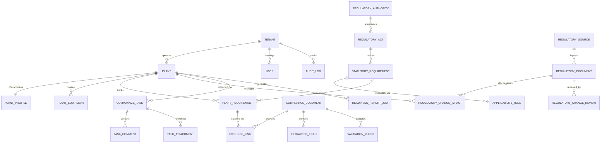
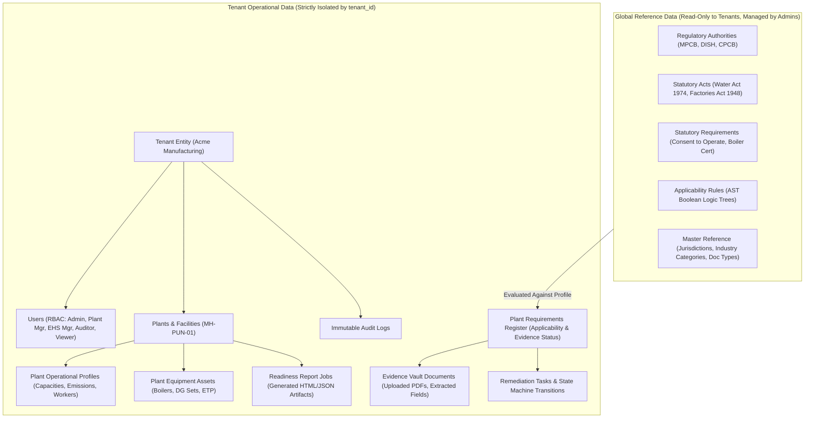
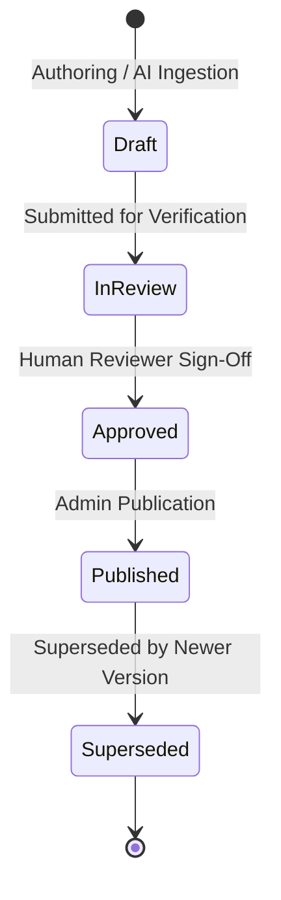

# PlantProof: Master Data Model & Schema Dictionary

**System Version:** v1.0.0  
**Data Architecture:** Multi-Tenant Relational Schema with Global Reference Master Data  
**Primary Engine:** PostgreSQL 16 (Production Target) / SQLite (Zero-Dependency Testing)  
**Status:** Grounded in Active SQLAlchemy Domain Models  

> [!IMPORTANT]
> **Data Governance Notice:** The regulatory catalog and applicability rules included in the initial release represent curated **seed and benchmark master data** for Indian manufacturing environments (Maharashtra & Central authorities). They do not constitute formal legal counsel and must be reviewed by qualified legal and environmental compliance counsel before operational certification.

---

## 1. Relational Entity Schema

All primary entities use version-4 UUID strings for primary keys to support multi-tenant isolation, safe distributed imports, and immutable audit trails. Timestamps are stored in UTC with timezone awareness.

---

## 2. Global Reference Master Data vs. Tenant Operational Data

PlantProof strictly decouples **Global Reference Master Data** (statutory legal catalog shared across all tenants) from **Tenant Operational Master Data** (facilities, profiles, uploaded evidence, remediation tasks).

---

## 3. Comprehensive Entity Glossary

### 3.1 Global Reference Master Data

#### `regulatory_authorities`
- **Purpose:** Central, State, and Municipal governing bodies empowered to issue statutory conditions and licenses.
- **Attributes:** `id` (UUID), `code` (`MPCB`, `DISH`, `CPCB`, `PESO`, `MoEFCC`), `name`, `jurisdiction_level` (`CENTRAL`, `STATE`, `LOCAL`), `website_url`.
- **Scope:** Global read-only reference data.

#### `regulatory_acts`
- **Purpose:** Statutory enactments and legal codes governing factory operations and environmental protection.
- **Attributes:** `id` (UUID), `authority_id` (FK), `title`, `short_name`, `year`.
- **Examples:** *Water (Prevention and Control of Pollution) Act, 1974*; *The Factories Act, 1948*; *The Boilers Act, 1923*.

#### `statutory_requirements`
- **Purpose:** Concrete legal obligations, licenses, or filings defined under statutory acts.
- **Attributes:** `id` (UUID), `act_id` (FK), `code` (`MPCB-CTO-EXPIRY`, `BOILER-INSP-CERT`, `DISH-FACTORY-LICENSE`), `title`, `description`, `obligation_type` (`CONSENT`, `LICENCE`, `CERTIFICATE`, `REGISTRATION`, `RETURN`), `validity_period_months`, `grace_period_days`.

#### `applicability_rules`
- **Purpose:** Deterministic boolean rule trees evaluated against plant profile attributes to decide whether an obligation applies.
- **Attributes:** `id` (UUID), `statutory_requirement_id` (FK), `rule_version` (Integer), `expression_ast` (JSON AST), `pass_explanation_template`, `fail_explanation_template`, `superseded_by_rule_id` (FK, nullable), `is_active` (Boolean).
- **Immutability:** Rules are never edited in place once published. New versions increment `rule_version` and set `superseded_by_rule_id`.

#### `master_data` Lookups
- `jurisdictions`: State and central territory definitions (`Maharashtra`, `Gujarat`, `Central`).
- `industry_categories`: CPCB pollution categorization (`RED`, `ORANGE`, `GREEN`, `WHITE`).
- `business_activities`: Manufacturing activity descriptors (`Chemical Manufacturing`, `Pharmaceuticals Formulation`, `Engineering & Machining`).
- `document_types`: Official evidence taxonomy (`Consent to Operate`, `Factory Licence`, `Boiler Certificate`, `Hazardous Waste Authorization`).

---

### 3.2 Tenant Operational Data

#### `tenants`
- **Purpose:** Top-level isolation boundary representing an enterprise manufacturing organization.
- **Attributes:** `id` (UUID), `name`, `code` (unique slug), `is_active`, `created_at`.

#### `users`
- **Purpose:** Authenticated personnel with defined role-based access privileges.
- **Attributes:** `id` (UUID), `tenant_id` (FK), `email` (unique), `full_name`, `hashed_password` (bcrypt), `role` (`SUPER_ADMIN`, `ADMIN`, `PLANT_MANAGER`, `EHS_MANAGER`, `AUDITOR`, `VIEWER`), `is_active`.

#### `plants`
- **Purpose:** Physical manufacturing factory or operational industrial installation.
- **Attributes:** `id` (UUID), `tenant_id` (FK), `name`, `code` (e.g., `MH-PUN-01`), `jurisdiction` (`Maharashtra`), `district` (`Pune`), `pincode`.

#### `plant_profiles`
- **Purpose:** Operational and physical attributes of the facility used by the deterministic applicability engine.
- **Attributes:** `id` (UUID), `plant_id` (FK, 1-to-1), `industry_category` (`RED`), `sector` (`Chemicals`), `employee_count`, `contract_labour_count`, `built_up_area_sqm`, `capital_investment_inr`, `connected_power_kw`, `dg_set_capacity_kva`, `hazardous_waste_tpa`, `effluent_discharge_kld`, `boiler_count`, `steam_capacity_tph`, `raw_attributes` (JSON).

#### `plant_equipment`
- **Purpose:** Tagged machinery inventory requiring periodic inspection or certification.
- **Attributes:** `id` (UUID), `plant_id` (FK), `equipment_type` (`BOILER`, `PRESSURE_VESSEL`, `DG_SET`, `ETP`, `CHIMNEY`), `tag_number` (`BLR-01`), `capacity` (`4.5 TPH`), `manufacturer`, `installation_date`.

#### `plant_requirements`
- **Purpose:** The instantiated statutory obligation for a specific plant, binding applicability logic with verified evidence.
- **Attributes:** `id` (UUID), `plant_id` (FK), `statutory_requirement_id` (FK), `applicability_status` (`APPLICABLE`, `CONDITIONALLY_APPLICABLE`, `EXEMPTED`, `NOT_APPLICABLE`), `applicability_rationale`, `evidence_status` (`VALID`, `EXPIRING_SOON`, `MISSING`, `EXPIRED`, `UNDER_REVIEW`, `NOT_REQUIRED`), `current_due_date` (Date), `owner_user_id` (FK), `last_evaluated_at`.

#### `compliance_documents`
- **Purpose:** Scanned regulatory certificates, licenses, and permits stored in the encrypted tenant vault.
- **Attributes:** `id` (UUID), `tenant_id` (FK), `plant_id` (FK), `original_filename`, `storage_path`, `mime_type`, `file_size_bytes`, `sha256_hash`, `review_status` (`PENDING_REVIEW`, `APPROVED`, `REJECTED`, `EDITED_AND_APPROVED`), `uploaded_by_user_id` (FK), `reviewed_by_user_id` (FK, nullable), `reviewed_at`.

#### `extracted_fields`
- **Purpose:** Individual data parameters extracted from documents by AI/OCR services.
- **Attributes:** `id` (UUID), `document_id` (FK), `field_key` (`certificate_number`, `valid_until`, `issuing_authority`), `extracted_value`, `confidence_score` (0.000–1.000), `confidence_band` (`HIGH`, `MEDIUM`, `LOW`), `is_overridden` (Boolean), `confirmed_value`, `source_page`, `source_snippet`.

#### `validation_checks`
- **Purpose:** Automated deterministic consistency validations evaluated on extracted fields.
- **Attributes:** `id` (UUID), `document_id` (FK), `check_code` (`DOC_TYPE_MATCH`, `VALID_DATE_WINDOW`, `CERT_FORMAT_VALID`, `AUTHORITY_RECOGNIZED`), `status` (`PASSED`, `WARNING`, `FAILED`), `details`.

#### `compliance_tasks`
- **Purpose:** Actionable remediation items and renewal workflows.
- **Attributes:** `id` (UUID), `plant_id` (FK), `plant_requirement_id` (FK, nullable), `title`, `description`, `due_date`, `priority` (`HIGH`, `MEDIUM`, `LOW`), `status` (`TODO`, `IN_PROGRESS`, `BLOCKED`, `COMPLETED`), `assigned_to_user_id` (FK).
- **Sub-entities:** `task_comments` (discussion thread), `task_attachments` (supporting files).

#### `readiness_report_jobs`
- **Purpose:** State and metadata for on-demand generated executive readiness dossiers.
- **Attributes:** `id` (UUID), `tenant_id` (FK), `plant_id` (FK), `requested_by_user_id` (FK), `report_title`, `status` (`QUEUED`, `GENERATING`, `COMPLETED`, `FAILED`), `file_format` (`HTML`, `JSON`), `storage_key` (path in vault), `summary_metrics` (JSON metrics snapshot), `data_as_of` (Date).

#### `audit_logs`
- **Purpose:** Non-repudiable record of all system mutations and review decisions.
- **Attributes:** `id` (UUID), `tenant_id` (FK), `user_id` (FK, nullable), `action` (`APPROVE_DOCUMENT`, `OVERRIDE_FIELD`, `UPDATE_PROFILE`, `PUBLISH_RULE`), `entity_type`, `entity_id`, `previous_state` (JSON), `new_state` (JSON), `timestamp` (UTC), `ip_address`.

---

## 4. Versioning & Immutability Architecture

PlantProof enforces strict versioning standards across regulatory rules and document audits:

1. **Rule Immutability:** Once published, an `applicability_rule` is never updated in place. Modifying a rule produces a new record with `rule_version = N + 1`, and the older version is preserved with `superseded_by_rule_id = new_rule.id`. Historical applicability evaluations maintain an explicit link to the exact rule version that produced them.
2. **Audit Trail Append-Only Guarantee:** The `audit_logs` table disallows `UPDATE` and `DELETE` statements at the application layer. Every profile update, document field override, and rule publication is recorded as a discrete append event.
3. **Evidence Immutability:** Uploaded document files are stored in the filesystem vault under their cryptographically derived UUID, and their SHA-256 hash is recorded. Approved documents cannot be overwritten; re-uploading an altered certificate creates a new document version.
