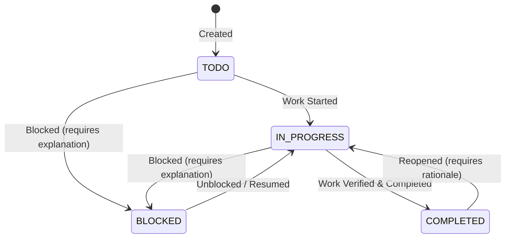

# PlantProof Operational Workflows & Engineering Specification

## 1. Overview & Architecture

This document specifies the operational workflows that transform statutory regulatory data into daily, actionable factory operations:

1. **Requirements Register:** Server-side paginated inventory of statutory requirements with faceted filtering, sorting, saved views, and slide-over provenance drawers.
2. **Controlled Task Management:** State-machine enforced compliance tasks with assignee, priority, due dates, comments, attachments, and mandatory justification for blocked workflows.
3. **Reminder & Notification Engine:** Due-soon and overdue scheduler with daily deduplication keys, user notification preferences, and a test notification adapter.
4. **Audit & Readiness Report Dossiers:** Traceable operational evidence reports (`HTML` and `JSON`) generated synchronously or via background workers, with cryptographic file storage and access isolation.
5. **Factory Master-Data Reassessment:** Dry-run prospective simulation returning attribute diffs and impacted requirement changes ("What Changed") before atomic live commit.
6. **Administrative Governance Audit Log:** Human-readable activity ledger free of raw machine JSON.

---

## 2. Cardinal Tenets & UX Rules

- **The Cardinal Regulatory Rule:** "AI Proposes, Humans Dispose."
- **The Cardinal UX Rule:** "No Raw Machine Artifacts in Customer-Facing Views." All machine outputs and error envelopes are mapped to human-readable labels, badges, and contextual remediation.
- **Readiness Reports Definition:** Reports are **"readiness and evidence reports"**, not legal certifications or warranties of compliance. All exports prominently display:
  - `"prepared_at"` (Generation timestamp in IST)
  - `"data_as_of"` (Point-in-time regulatory and profile snapshot)
  - Explicit list of missing / unverified gap items
  - Statutory provenance citations
  - Executive legal disclaimer banner

---

## 3. Endpoints & API Contract Reference

| Module | Method | Path | Description |
|---|---|---|---|
| **Requirements** | `GET` | `/api/v1/requirements` | Paginated requirement obligations with filters (`status`, `authority`, `search`, `saved_view`) |
| **Requirements** | `GET` | `/api/v1/requirements/saved-views` | List saved view presets (e.g., `ACTION_REQUIRED`, `CRITICAL_EHS`) |
| **Requirements** | `GET` | `/api/v1/requirements/{id}/provenance` | Requirement details with Act, Section, Gazette URL, applicability reason, and evidence |
| **Tasks** | `GET` | `/api/v1/tasks` | Paginated tasks with status (`TODO`, `IN_PROGRESS`, `BLOCKED`, `COMPLETED`) and priority filters |
| **Tasks** | `POST` | `/api/v1/tasks` | Create task linked to plant and optional requirement |
| **Tasks** | `GET` | `/api/v1/tasks/{id}` | Detailed task with comments and attachments |
| **Tasks** | `POST` | `/api/v1/tasks/{id}/transitions` | Controlled state transition (`BLOCKED` requires `comment`) |
| **Tasks** | `POST` | `/api/v1/tasks/{id}/comments` | Add timestamped collaboration comment |
| **Reminders** | `GET` | `/api/v1/reminders/notifications` | Paginated user notifications with unread count |
| **Reminders** | `PATCH` | `/api/v1/reminders/notifications/{id}/read` | Mark individual notification as read |
| **Reminders** | `POST` | `/api/v1/reminders/notifications/read-all` | Mark all unread notifications as read |
| **Reminders** | `POST` | `/api/v1/reminders/run-scheduler` | Trigger reminder evaluation scan with deduplication |
| **Reminders** | `GET` | `/api/v1/reminders/preferences` | Retrieve notification lead times and channel preferences |
| **Reminders** | `PUT` | `/api/v1/reminders/preferences` | Update notification preferences |
| **Reminders** | `POST` | `/api/v1/reminders/test-notification` | Dispatch test notification via `TestNotificationAdapter` |
| **Reports** | `GET` | `/api/v1/reports` | Paginated archive of generated readiness reports |
| **Reports** | `POST` | `/api/v1/reports` | Build readiness report (`HTML`/`JSON`, sync or `run_async=true`) |
| **Reports** | `GET` | `/api/v1/reports/{id}` | Poll report job status and summary metrics |
| **Reports** | `GET` | `/api/v1/reports/{id}/download` | Secure `FileResponse` download with tenant isolation |
| **Profile** | `POST` | `/api/v1/companies/{plant_id}/simulate-reassessment` | Dry-run prospective simulation returning "What Changed" diff |
| **Profile** | `PUT` | `/api/v1/companies/{plant_id}/profile-with-reassessment` | Atomically apply updates, update baseline version, and trigger reassessment |
| **Audit** | `GET` | `/api/v1/admin/audit-logs` | Paginated governance activity ledger with human-readable descriptions |

---

## 4. State Machines & Validation Logic

### 4.1 Task Lifecycle State Machine


- When moving to `BLOCKED`, the system enforces a non-empty `comment` explaining the operational dependency (e.g. *Awaiting external laboratory emission testing report*).
- When reopening a `COMPLETED` task, the state reverts to `IN_PROGRESS` and an audit entry is created.

### 4.2 Reminder Deduplication
To prevent notification storms, the reminder engine constructs a unique daily composite key:
```python
dedup_key = f"{scan_date}:{entity_type}:{entity_id}:{notification_type}:{channel}"
```
If an in-app or email reminder has already been created for that entity and notification type on that day, subsequent scheduler passes bypass dispatch.

---

## 5. Verification & Testing Evidence

- **Test Suite:** `tests/integration/test_operational_workflows.py`
  - `test_requirements_pagination_filters_and_saved_views` (PASSED)
  - `test_requirement_detail_provenance_and_history` (PASSED)
  - `test_tasks_lifecycle_and_controlled_state_machine` (PASSED)
  - `test_reminders_scheduler_deduplication_and_test_adapter` (PASSED)
  - `test_readiness_report_builder_and_access_isolation` (PASSED)
  - `test_profile_simulation_diff_and_reassessment_application` (PASSED)
  - `test_admin_audit_logs_human_readable_descriptions` (PASSED)
- **Repository Total:** 83/83 tests passing (100% pass rate).
- **Frontend Build:** `tsc -b && vite build` completed cleanly in 727ms with zero errors.
