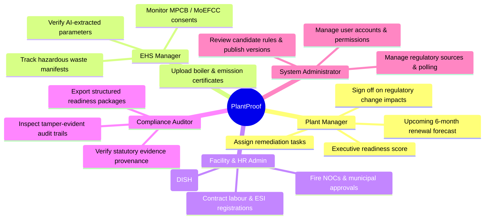

# PlantProof: Product Overview & Capabilities

**System Version:** v1.0.0  
**Target Market:** Indian Industrial Manufacturing (Maharashtra, Gujarat, Central Statutes)  
**Primary Authorities:** MPCB, CPCB, DISH (Directorate of Industrial Safety & Health), PESO, MoEFCC  
**Document Status:** Current Implementation State  

---

## 1. Executive Summary

Manufacturing enterprises in India operate within an intricate web of environmental, labour, industrial safety, and public health statutory mandates. An average chemical, engineering, or pharmaceutical plant must track between 40 and 120 recurring licences, consents, registrations, equipment inspection certificates, and periodic statutory returns across central, state, and local bodies.

**PlantProof** transforms this compliance burden from a reactive, spreadsheet-based liability into a deterministic, auditable, and automated compliance command center.

The platform bridges official government notifications, enterprise operational master data, deterministic rule-based applicability, AI-assisted document verification, human-in-the-loop auditability, and executive readiness reporting.

---

## 2. Target Customer & User Personas

### 2.1 Target Customer Segment
PlantProof is engineered specifically for manufacturing organizations with physical production facilities in India:
- **Industry Verticals:** Specialty chemicals, pharmaceuticals, heavy engineering, automotive components, and metallurgical processing plants.
- **Facility Classifications:** CPCB Red, Orange, and Green category industrial plants with hazardous operations, high-pressure steam boilers, effluent treatment plants (ETP), and contract labor workforces.
- **Operational Scale:** Multi-plant manufacturing corporations, mid-market factory operators, and specialized industrial units located in state industrial zones (e.g., MIDC in Maharashtra, GIDC in Gujarat).

### 2.2 Key Personas & Roles

1. **Plant Manager (e.g., Rohit Sharma - `PLANT_MANAGER`):**  
   *Needs:* High-level situational awareness of factory risk, upcoming statutory deadlines across the next 30 to 180 days, and assurance that no license expiry will halt operations.  
   *Key Views:* Executive Dashboard KPIs, Renewal Forecast, Needs Attention Queue.

2. **EHS Manager (e.g., Priya Deshmukh - `EHS_MANAGER`):**  
   *Needs:* Granular tracking of environmental consents (Consent to Establish/Operate), hazardous waste authorisations, water cess filings, air emission testing, and boiler inspection certificates.  
   *Key Views:* Requirements Register, Dual-Pane Document Review Workbench, Regulatory Intelligence Feed.

3. **Facility & HR Admin (e.g., Amit Jadhav - `ADMIN`):**  
   *Needs:* Tracking factory licenses under the Factories Act, 1948, building plan approvals, fire safety NOCs, contract labour licenses, and ESI/PF statutory registrations.  
   *Key Views:* Facility Profile, Team Management, Remediation Tasks, Evidence Vault.

4. **Compliance Auditor (e.g., Vikram Mehta - `AUDITOR`):**  
   *Needs:* Traceable proof of compliance, chain of custody for all uploaded certificates, verification stamps, and tamper-proof audit trails.  
   *Key Views:* Read-only Requirements Register, Audit Logs, Evidence Dossiers.

5. **Read-Only Stakeholder (e.g., Sneha Patil - `VIEWER`):**  
   *Needs:* Read-only inspection of facility compliance status and requirements without operational mutation privileges.  
   *Key Views:* Dashboard, Requirements Listing.

---

## 3. Core Operational Workflows

### Workflow 1: Facility Onboarding & Applicability Assessment
1. **Facility Profiling:** User inputs plant location (State, District, Industrial Zone), pollution category (Red/Orange/Green), operational equipment (Boilers, DG sets, ETP, Chimneys), and workforce parameters.
2. **Deterministic Evaluation:** The system evaluates published statutory rules against the plant profile using transparent boolean logic trees.
3. **Register Generation:** Every statutory requirement is marked as `APPLICABLE`, `CONDITIONALLY_APPLICABLE`, or `EXEMPTED`, with full statutory provenance and clause citations.

### Workflow 2: Evidence Upload, AI Extraction & Human Review
1. **Evidence Upload:** EHS officers upload official certificates (PDF, JPG, PNG) into the encrypted tenant storage vault.
2. **AI-Assisted Extraction:** Text is extracted, classified, and mapped into structured fields (certificate number, issue date, valid until date, issuing authority, equipment tag) with confidence scores.
3. **Human-in-the-Loop Review:** An authorized reviewer verifies extracted values side-by-side with the original document preview, accepts or overrides fields, and links the certificate to applicable requirements.
4. **Audit Trail:** The acceptance or override is recorded in an immutable audit log with user ID, timestamps, and previous state diffs.

### Workflow 3: Regulatory Change Ingestion & Facility Impact Simulation
1. **Source Monitoring:** Background schedulers poll official government portals (MPCB, CPCB, DISH) for new gazette notifications and circulars.
2. **Deduplication & Extraction:** Documents are hashed (SHA-256) and plain-language summaries with candidate rule diffs are generated.
3. **Automated Impact Assessment:** The engine checks active plant profiles to identify affected facilities (e.g., plants with coal boilers or hazardous waste generation).
4. **Human Review & Publication:** Platform administrators review candidate rules, approve or modify them, and publish immutable new rule versions that supersede previous revisions.

### Workflow 4: Remediation Task Management & Alerting
1. **Deficiency Tracking:** When evidence is missing, expired, or non-compliant, remediation tasks are created with assigned owners, due dates, and priorities.
2. **Controlled State Machine:** Tasks transition through validated states: `TODO` $\rightarrow$ `IN_PROGRESS` $\rightarrow$ `BLOCKED` $\rightarrow$ `COMPLETED`, requiring explanations for blockages.
3. **Multi-Channel Reminders:** The scheduler dispatches in-app and webhook alerts for items due soon (30 days, 15 days, 7 days) and overdue obligations.

### Workflow 5: Executive Readiness Reporting
1. **Dossier Builder:** Plant managers configure an on-demand audit readiness report with date ranges, evidence attachments, and gap summaries.
2. **Readiness Score Calculation:** Evaluates evidence coverage against all applicable requirements.
3. **Safe Artifact Generation:** Generates downloadable HTML or JSON reports with prominent legal disclaimers, XSS protection, and tenant access isolation.

---

## 4. Scope Boundaries & Non-Goals

To maintain legal integrity, engineering safety, and enterprise reliability, PlantProof enforces strict architectural non-goals:

| Capability | In Scope (Implemented) | Non-Goal (Explicitly Out of Scope) |
| :--- | :--- | :--- |
| **Legal Status** | Deterministic readiness scoring and evidence tracking. | **NOT a formal legal opinion or certification.** PlantProof never claims an enterprise is "legally certified compliant." |
| **Government Portal Interaction** | Polling public notification pages and circulars. | **NO automated bot form submission** or direct filings into government portals (e.g., MPCB e-portal or DISH filings). |
| **AI Decision Making** | Proposing extracted parameters and drafting candidate rule diffs. | **NO silent AI mutations.** AI proposes; authorized human officers must approve all rule publications and document approvals. |
| **Document Retention** | Encrypted tenant-isolated file storage with integrity hashing. | **NOT a permanent public archive.** Document lifecycle management remains the enterprise's operational responsibility. |
| **Deployment Procedures** | Local development, multi-tenant isolation, automated test verification. | **Cloud deployment procedures and production CI/CD pipelines are out of scope** for this repository. |

---

## 5. Technology Stack Summary

- **Backend:** Python 3.11/3.13, FastAPI, SQLAlchemy 2.0 ORM, Pydantic v2 schemas, Alembic migrations.
- **Frontend:** React 19, TypeScript (strict mode), Vite, TanStack Query, React Hook Form, Zod validation, Lucide React icons, accessible CSS design tokens.
- **Persistence & Storage:** PostgreSQL 16 (production target) / SQLite (isolated local dev & testing), Local partitioned file vault.
- **Security:** Bcrypt password hashing, HMAC-SHA256 JWTs, sliding-window rate limiting, strict HTTP security headers, automated PII/secret redaction.
