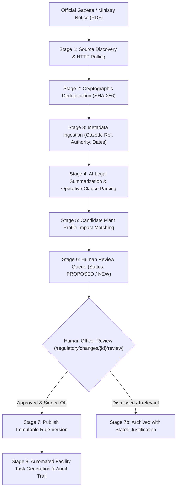

# PlantProof: Regulatory Data Governance & Provenance Policy

**System Version:** v1.0.0  
**Effective As Of:** October 2026  
**Target Jurisdictions:** Central Government of India, State of Maharashtra (MPCB, DISH), State of Gujarat (GPCB)  
**Status:** Grounded in Active System Implementation  

---

## 1. Governance Principles & Legal Accountability

Statutory environmental and industrial safety data carries direct legal, operational, and financial liability. Erroneous data can lead to stop-work notices, plant closure orders under Section 33A of the Water Act or Section 31A of the Air Act, or criminal citations under the Factories Act, 1948.

To eliminate compliance risk, PlantProof enforces three non-negotiable governance tenets:

### 1.1 The Cardinal Regulatory Rule: "AI Proposes, Humans Dispose"
- Artificial intelligence models (OCR parsers, LLM summarizers, categorization heuristics) are strictly **proposing agents**.
- AI must **never** silently publish legal interpretations, alter statutory registers without human approval, or certify an enterprise as "compliant."
- Every automated extraction, candidate impact, or draft rule amendment requires explicit human review and sign-off by an authorized compliance officer.

### 1.2 The Provenance Mandate
Every statutory requirement, amendment, threshold, or filing window in the system must be directly grounded in a primary legal instrument:
1. **Official Citation:** Gazette notification number (e.g., `S.O. 1234(E)`), circular number, or government resolution.
2. **Issuing Authority:** Official statutory body (e.g., `MoEFCC`, `CPCB`, `MPCB`, `DISH Maharashtra`, `PESO`).
3. **Official Gazette Link & Artifact:** Permanent URI to the official government gazette or stored original PDF in the document vault with cryptographic SHA-256 fingerprinting.
4. **Effective Enforcement Date:** Explicit distinction between the date of publication in the official gazette and the date the notification comes into legal force.

### 1.3 Immutability & Temporal Rule Versioning
Regulatory rules change over time. When an amendment alters a statutory threshold (e.g., hazardous waste storage limits changing from 90 days to 180 days), the system **never overwrites** historical records:
- The previous rule version remains pinned to all historical audit snapshots and evidence submissions.
- A new monotonic rule version (`rule_version = N + 1`) is published with an effective start date.
- Historical applicability evaluations maintain an explicit link to the exact rule version that was legally in force on the inspection or evaluation date.

---

## 2. Official Source Inventory & Access Methods

PlantProof interfaces exclusively with official government portals and gazettes. The active registry is accessible via `GET /api/v1/regulatory/sources`:

| Source Identifier | Issuing Authority & Ownership | Base URL | Authorized Ingestion Method | Refresh Interval | Source Reliability Tier |
| :--- | :--- | :--- | :--- | :--- | :---: |
| **`IN-EGAZETTE`** | Directorate of Printing, MoHUA, Government of India | `https://egazette.gov.in` | Public HTTP query on Daily Gazette Archive (Part II Section 3) | Daily (02:00 UTC) | **High** (99.1%) |
| **`MH-MPCB`** | Maharashtra Pollution Control Board | `https://mpcb.gov.in/circulars-notifications` | Public HTTP GET on Circulars & Notifications listing | Weekly (Monday 04:00 UTC) | **Medium** (95.4%) |
| **`IN-CPCB`** | Central Pollution Control Board, MoEFCC | `https://cpcb.nic.in/notifications` | Public HTTP GET on Statutory Notifications portal | Twice Weekly | **High** (98.5%) |
| **`MH-DISH`** | Directorate of Industrial Safety & Health, Maharashtra | `https://dish.maharashtra.gov.in` | Public HTTP GET on Safety Circulars & Rules section | Weekly | **Medium** (94.2%) |
| **`IN-MOEFCC`** | Ministry of Environment, Forest & Climate Change | `https://moef.gov.in/en/rules-regulations` | Public HTTP GET on Environmental Acts & Rules | Monthly | **High** (98.8%) |
| **`LOCAL-FIXTURE`**| PlantProof Local Test Bench | `fixture://regulatory-vault/demo-feed` | Local File System Ingestion | On-Demand / Real-time | **Guaranteed** (100.0%) |

---

## 3. Regulatory Ingestion Lifecycle

The regulatory intelligence lifecycle moves documents through 8 deterministic stages from discovery to facility task generation:



### Stage Details

1. **Stage 1 - Source Discovery:** Schedulers poll configured URLs with a maximum request rate of 1 req/5s per domain.
2. **Stage 2 - Deduplication:** File binaries are hashed with SHA-256. If a document hash already exists in `regulatory_documents`, ingestion terminates idempotently without duplicate records.
3. **Stage 3 - Provenance Metadata:** Captures publication date, gazette notification number, issuing authority code, and source URL.
4. **Stage 4 - Plain-Language Summarization:** Generates an executive summary answering: *What changed?*, *Who is affected?*, and *What action is required?*.
5. **Stage 5 - Impact Matching:** Evaluates active tenant plant profiles to identify affected facilities (e.g., plants located in Maharashtra possessing steam boilers or producing hazardous waste).
6. **Stage 6 - Human Review Queue:** Changes enter state `PROPOSED` or `NEW`.
7. **Stage 7 - Human Sign-Off:** An authorized compliance officer (`PLANT_MANAGER`, `EHS_MANAGER`, or `ADMIN`) reviews the change, confirms facility applicability, and publishes rule versions via `POST /api/v1/admin/rules/{rule_id}/approve` or `POST /api/v1/admin/rules/{rule_id}/supersede`.
8. **Stage 8 - Operational Tasks:** Remediation tasks are generated in `compliance_tasks`, linked to facility requirements, and logged to `audit_logs`.

---

## 4. Human Review State Machine & Audit Records

```
[ PROPOSED / NEW ] 
       │
       ▼
[ UNDER_REVIEW ] ──── (Officer adds legal notes / refines impact scope)
       │
       ├──► [ APPROVED / APPLIED ]  (Updates plant registers & triggers remediation tasks)
       │
       └──► [ REJECTED / ARCHIVED ] (Dismissed with mandatory explanation)
```

Every review transition requires:
1. **Authenticated Actor:** User ID and email recorded.
2. **Explicit Decision:** `APPROVED`, `REJECTED`, or `EDITED_AND_APPROVED`.
3. **Written Justification:** Required rationale explaining the operational decision.
4. **Non-Repudiation:** Stored in `regulatory_change_reviews` and `audit_logs` with UTC timestamps.

---

## 5. Source Limitations & Operational Constraints

1. **Unannounced Portal Downtime:** Indian government portals experience periodic maintenance without advance notice. The system tracks health via `GET /api/v1/regulatory/sources/{source_id}/health`. Persistent failures mark the source as `DEGRADED` without breaking application availability.
2. **Scanned & Non-Searchable Vernacular PDFs:** Certain state notifications (e.g., MPCB or DISH notices published in Marathi) consist of low-resolution scanned bitmap PDFs without native text layers. In such cases, OCR confidence reflects visual quality and falls back to mandatory manual transcription.
3. **Dynamic Portal Restructuring:** Government portal redesigns that alter URL hierarchies or HTML DOM structures are flagged by source health checks as layout mismatches, alerting system administrators.
4. **Rate Limiting & Anti-Scraping:** Government portals do not provide official REST APIs. Ingestion strictly adheres to `robots.txt` guidelines and rate limits to prevent denial of service on public servers.
