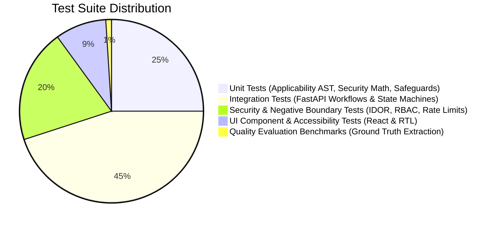

# PlantProof: Test Strategy & Quality Assurance Plan

**System Version:** v1.0.0  
**Current Backend Suite:** 97 Tests (100% Pass Rate)  
**Current Frontend Suite:** 11 Vitest Component Tests (100% Pass Rate)  
**Primary Test Frameworks:** `pytest` + `pytest-asyncio` (Backend), `vitest` + `@testing-library/react` (Frontend)  
**Status:** Grounded in Actual Test Suite Implementation  

---

## 1. Testing Philosophy & Quality Pyramid

PlantProof enforces a strict test-driven engineering discipline. Because compliance failures trigger statutory penalties, the testing pyramid prioritizes deterministic rule verification and strict negative security boundaries:



### 1.1 Non-Negotiable Quality Principles
1. **Zero-Flake Determinism:** Applicability rule evaluation, date calculations, and status transitions must execute deterministically without unpinned network or external LLM dependencies in the test runner.
2. **Local Zero-Dependency Test Execution:** The test suite runs out-of-the-box using an in-memory SQLite database initialized in `tests/conftest.py`, ensuring instantaneous test runs without spinning up external database containers.
3. **Cardinal Tenet Verification:** Automated tests assert that AI models cannot silently approve documents or alter active registers without human review.
4. **Mandatory Negative Testing:** Every security control (multi-tenancy isolation, RBAC role restrictions, rate limiters, path traversal guards) is backed by explicit negative tests expecting `HTTP 403`, `HTTP 404`, `HTTP 409`, or `HTTP 429`.

---

## 2. Test Suite Architecture & Directory Structure

```text
tests/
├── conftest.py                       # Session fixtures, in-memory DB, auth header helpers, rate limit reset
├── evaluation/
│   └── test_extraction_quality.py   # Ground-truth benchmark evaluation for parameter extraction
├── fixtures/
│   └── document_fixtures.py          # Synthetic PDFs, hostile injection samples, oversized files
├── integration/
│   ├── test_admin_rules_bench.py     # Rule authoring, approval, and version supersession
│   ├── test_applicability_api.py     # Company profile reassessment simulation and evaluation
│   ├── test_auth_api.py              # Login, token validation, user listing
│   ├── test_document_management.py   # Vault upload, MIME checks, SHA-256 deduplication, review
│   ├── test_health_and_logging.py    # Health probes, correlation ID propagation, error envelope
│   ├── test_master_data_api.py       # Catalog lookups (authorities, acts, document types)
│   ├── test_operational_workflows.py # Paginated requirements, tasks, reminders, report builder
│   ├── test_plants_api.py            # Facility profiles, equipment inventories
│   ├── test_regulatory_pipeline.py   # 8-stage gazette ingestion, source health, change review
│   ├── test_security_hardening.py    # Dedicated negative security suite (IDOR, RBAC, Rate limits)
│   └── test_tenant_safety.py         # Cross-tenant data isolation and profile protections
└── unit/
    ├── test_applicability_engine.py  # Boolean AST operators, nested logic trees, missing attributes
    ├── test_migrations.py            # Database schema and Alembic revision checks
    ├── test_regulatory_safeguards.py # Human sign-off boundaries, permanent licence expiry rule
    └── test_security.py              # Password hashing, JWT creation, token expiration math
```

---

## 3. Test Layers & Scope

### 3.1 Unit Testing
- **Applicability AST Engine:** Tests all relational operators (`==`, `!=`, `>`, `<`, `>=`, `<=`, `in`, `contains`), boolean combinations (`AND`, `OR`, `NOT`), threshold comparisons, and missing plant profile attribute handling in `tests/unit/test_applicability_engine.py`.
- **Statutory Safeguards:** Asserts that permanent documents (Factory Licences) never have expiry dates invented, and verifies that draft rules cannot affect production registers in `tests/unit/test_regulatory_safeguards.py`.
- **Security Math:** Validates bcrypt password hashing work factors, JWT signature generation, and expiration math in `tests/unit/test_security.py`.

### 3.2 Integration Testing
- **Operational Workflows:** Tests the complete factory lifecycle across paginated requirements registers, saved view presets, task state machine transitions (`TODO` $\rightarrow$ `IN_PROGRESS` $\rightarrow$ `BLOCKED` $\rightarrow$ `COMPLETED`), notification dispatches, and readiness dossier generation in `tests/integration/test_operational_workflows.py`.
- **Document & Evidence Vault:** Tests file uploads, cryptographic SHA-256 duplicate detection, deterministic validation checks (`DOC_TYPE_MATCH`, `VALID_DATE_WINDOW`), and split-pane human review in `tests/integration/test_document_management.py`.
- **Regulatory Pipeline:** Tests the 8-stage ingestion process from source polling to plant profile impact matching in `tests/integration/test_regulatory_pipeline.py`.

### 3.3 Negative Security Testing
- **Cross-Tenant IDOR/BOLA:** Verifies that Tenant A cannot access Tenant B's plants, profile attributes, equipment, uploaded documents, generated reports, or remediation tasks (expecting HTTP 403/404) in `tests/integration/test_security_hardening.py` and `tests/integration/test_tenant_safety.py`.
- **Server-Side RBAC Denials:** Verifies that read-only `VIEWER` accounts are rejected when attempting to invite users, register facilities, or view audit logs.
- **Privilege Escalation:** Verifies that a tenant `ADMIN` is strictly forbidden from inviting a `SUPER_ADMIN`.
- **Rate Limiting:** Asserts that issuing 16 rapid requests to `/api/v1/auth/login` triggers `HTTP 429 Too Many Requests` with a valid `Retry-After` header.
- **Path Traversal & Header Injection:** Asserts that report downloads with `../../etc/passwd` storage keys are rejected, and filenames in `Content-Disposition` headers are sanitized.

### 3.4 Frontend Component & UI Testing
- **Framework:** `vitest` with `@testing-library/react` and `jsdom`.
- **Location:** `frontend/src/__tests__/`.
- **Suites:**
  - `AuthPage.test.tsx`: Tests tab switching (Sign In, Accept Invite, Password Reset), form validation, and login submission.
  - `SetupWizardPage.test.tsx`: Tests multi-step onboarding wizard navigation, validation, and profile persistence.
  - `AIAssistantModal.test.tsx`: Tests interactive modal rendering, sample prompt clicks, and query generation.
  - `ProtectedRoute.test.tsx`: Tests unauthenticated redirection to `/login` and role-based route gating.

### 3.5 Accessibility (a11y) Testing
- **Standard:** WCAG 2.1 AA Compliance.
- **Color Contrast:** Deep Forest Green (`#06281e`), Emerald (`#059669`), and Slate text tokens provide minimum 4.5:1 contrast against light backgrounds.
- **Semantic HTML & Screen Readers:** Form inputs carry associated `<label>` elements; interactive buttons have explicit `aria-label` tags; modal dialogs implement focus trapping and `aria-modal="true"`.
- **Keyboard Navigation:** All interactive elements (sidebar navigation, tabs, data table pagination, review actions) support full keyboard `Tab`, `Enter`, and `Escape` control.

### 3.6 Performance & Load Testing
- **Harness:** Documented in [LOAD_TEST_RUNBOOK.md](file:///d:/Complaince%20System/docs/LOAD_TEST_RUNBOOK.md).
- **Scenarios:** Concurrent authentication, high-throughput requirements browsing, multi-file upload burst, and parallel readiness report generation.
- **Metrics Tracked:** Latency percentiles (p50, p95, p99), requests per second (RPS), error rates, and database connection pool saturation.

---

## 4. Test Execution Runbook

### 4.1 Running Backend Tests
```bash
# Execute entire pytest suite (97 tests)
.\venv\Scripts\pytest.exe -v

# Run specific test file
.\venv\Scripts\pytest.exe tests/integration/test_security_hardening.py -v

# Run with short summary
.\venv\Scripts\pytest.exe -q
```

### 4.2 Running Frontend Tests
```bash
# Navigate to frontend directory
cd frontend

# Execute vitest test suite (11 tests)
npm test

# Run tests with coverage
npm test -- --coverage
```

### 4.3 Running Local Security Audits
```bash
# Frontend dependency vulnerability scan
cd frontend
npm audit

# Python package inspection
..\venv\Scripts\python.exe -m pip list
```
