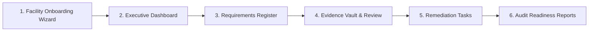

# PlantProof: User Guide & Operational Manual

---

## 1. Getting Started & Facility Setup

Welcome to **PlantProof**. This guide provides practical, non-technical instructions for plant managers, environmental safety officers, factory administrators, and internal compliance auditors.

### 1.1 Demo Login Personas (Synthetic Test Accounts)
To explore PlantProof locally, use one of the pre-seeded enterprise accounts (Password: `DemoPass123!`):
- **Rohit Sharma (`rohit.sharma@acme-mfg.in`):** Plant Manager (Acme Manufacturing - Pune Unit). Full operational control, report generation, task assignment, and regulatory sign-offs.
- **Priya Deshmukh (`priya.deshmukh@acme-mfg.in`):** EHS Manager. Evidence uploads, OCR extractions, parameter overrides, and environmental consents.
- **Amit Jadhav (`amit.jadhav@acme-mfg.in`):** Facility & HR Administrator. Team member invitations, factory licenses, and profile adjustments.
- **Vikram Mehta (`vikram.mehta@acme-mfg.in`):** Compliance Auditor. Read-only inspection of evidence registers, audit trails, and export dossiers.
- **Sneha Patil (`sneha.patil@acme-mfg.in`):** Read-only Viewer. Dashboard and requirement register visibility.
- **Vikram Singh (`vikram.singh@beta-pharma.in`):** Tenant B (Beta Pharma - Ahmedabad Plant). Proves complete multi-tenant data isolation.

### 1.2 Onboarding Wizard (`/setup-wizard`)
For new facilities, the step-by-step Onboarding Wizard configures your operational profile and automatically determines applicable statutory obligations:
1. **Step 1 - Plant Location & Identity:** Enter your facility name, operational unit code (e.g., `MH-PUN-01`), State jurisdiction (*Maharashtra* or *Gujarat*), District, and industrial zone (e.g., MIDC Kurkumbh).
2. **Step 2 - Pollution & Sector Classification:** Select your CPCB pollution category (*Red*, *Orange*, *Green*, or *White*) and industrial sector (*Chemicals*, *Pharmaceuticals*, *Automotive*, or *Engineering*).
3. **Step 3 - Equipment & Capacities:** Specify high-risk plant assets:
   - High-pressure steam boilers (capacity in Tons Per Hour - TPH).
   - Backup Diesel Generator (DG) sets (rating in kVA).
   - Effluent Treatment Plant (ETP capacity in Kilo-Litres/Day - KLD).
   - Storage of hazardous chemicals or toxic materials (tonnes per year).
4. **Step 4 - Workforce & Factory Scope:** Enter permanent worker headcount and contract labour headcount.
5. **Step 5 - Generate Compliance Register:** The deterministic engine evaluates all published statutory rules against your profile and creates your personalized Requirements Register.




---

## 2. Navigating the Executive Dashboard (`/dashboard`)

The Executive Dashboard provides an instant snapshot of plant compliance health and near-term operational risk.

### 2.1 Key Stat Cards
- **Requirements (48):** Total statutory obligations tracked for the facility (e.g. 36 applicable, 12 not applicable).
- **Due Soon (12):** Obligations requiring statutory renewal or periodic return filing in the next 30 days.
- **Evidence Gaps (8):** Applicable obligations currently missing a valid certificate or containing an expired document.
- **Regulatory Changes (5):** Recent government gazette notifications that may impact operations (2 pending human review).

### 2.2 Visual Analytics
- **Compliance Status Donut:** Visualizes total readiness (e.g. 75% Compliant), broken down into Compliant (36), Due Soon (12), Overdue (6), and Not Applicable (8).
- **Upcoming Deadlines Bar Chart:** Displays upcoming statutory renewal and submission obligations across the next 6 months (Oct to Mar).

### 2.3 The "Needs Attention" Priority Queue
Lists urgent action items sorted by severity:
- **Overdue (Red Badge):** Immediate risk (e.g., Consent to Operate expired on 15 Oct 2025).
- **Due Soon (Amber Badge):** Advance notice (e.g., Factory Licence Renewal due on 28 Oct 2025).

---

## 3. Managing the Requirements Register (`/requirements`)

The Requirements Register is the centralized inventory of all statutory licences, consents, and certificates.

### 3.1 Faceted Filtering & Search
- **Jurisdiction Filter:** Narrow obligations by territory (e.g., *Maharashtra*, *Central*).
- **Industry Filter:** Filter by industrial sector (e.g., *Chemicals*, *Manufacturing*).
- **Status Filter:** Select specific operational states (*Valid*, *Expiring Soon*, *Missing*, *Overdue*, *Conditionally Applicable*).
- **Search Bar:** Real-time keyword search across requirement titles and authority names.

### 3.2 Columns & Indicators
- **Requirement Name:** Statutory obligation title (e.g., *Consent to Operate*, *Boiler Inspection Certificate*).
- **Authority:** Issuing body badge (e.g., *MPCB*, *Chief Inspector of Boilers*, *Labour Department*).
- **Applicability:** Deterministic engine determination (*Applicable*, *Conditionally Applicable*, *Exempted*).
- **Evidence Status:** Current status pill (*Valid* green, *Expiring Soon* amber, *Missing* red).
- **Due Date:** Target renewal or return deadline.
- **Owner:** Assigned staff member avatar and name (*Priya Deshmukh - EHS Manager*).

---

## 4. Document & Evidence Vault (`/documents`)

The Compliance Document Vault allows plant managers and compliance officers to upload, inspect, verify, and link compliance evidence documents safely.

### 4.1 Document Vault Inventory & Upload
- **Safe Upload Modal:** Select target facility and upload documents in PDF, PNG, JPG, or TIFF formats (max 25MB). Executable and archive formats are blocked.
- **Cryptographic Duplicate Detection:** Documents are checked via SHA-256 hash. Identical uploads are flagged with a **Duplicate Hash** pill and preserved separately without silent merging.
- **Status Filtering:** Filter documents by facility, extraction state (*Extracted*, *Queued*, *Failed*), and review state (*Pending Review*, *Approved*, *Edited & Approved*, *Rejected*).

### 4.2 Dual-Pane Human Review & Grounded Verification
Click **Review & Verify** on any document to enter the dual-pane verification view:
- **Left Pane (Document Viewer):** Interactive viewer with zoom (50% to 200%), page navigation, raw file streaming, and cryptographic SHA-256 / storage key verification.
- **Right Pane (Parameters & Validation):**
  - **Extracted Fields & Citations:** Displays key fields with confidence scores (**High** green, **Medium** amber, **Low** red), page citation tags, and verbatim source snippet quotes.
  - **Reviewer Overrides:** Click **Edit Fields** to correct OCR values. Overridden fields are highlighted and stamped with an **Edited by Reviewer** badge.
  - **Deterministic Rule Checks:** Automated verification for document type classification, certificate syntax regex, recognized authorities, and temporal date sequences.
  - **Cardinal Rule for Permanent Licences:** For lifetime factory registrations or permanent consents, the system preserves `No Expiry` and will never invent an artificial expiration date.
  - **Evidence Linking:** Select the statutory requirement (e.g. `BOILER-INSP-CERT`, `MPCB-CTO`) to link the approved document as verified compliance evidence.
  - **Configurable Expiry Reminders:** Set lead-time alert windows (30, 60, or 90 days before expiration) or none for permanent certificates.
  - **Immutable Audit Trail:** Switch to the audit tab to review complete provenance events (`DOCUMENT_UPLOADED`, `EXTRACTION_COMPLETED`, `FIELD_OVERRIDDEN`, `DOCUMENT_APPROVED`, `EVIDENCE_LINKED`) with user email and timestamp. No raw machine JSON is displayed.

### 4.3 Review Controls
- **Save Field Overrides:** Persists human edits to extracted fields with audit logs.
- **Approve as Evidence:** Commits verified parameters, updates linked requirement status to `VALID`, and logs approval.
- **Reject Document:** Prompts for mandatory compliance rationale and flags document as `REJECTED`, leaving the legal requirement unmet.
- **Re-Extract:** Re-runs extraction in case of source updates or schema version upgrades.

---

## 5. Reviewing Regulatory Changes (`/regulatory-changes/:id`)

When new central or state gazette notifications are published, they appear in the Regulatory Changes feed:

1. **Header Metadata:** Displays notification reference (e.g., `S.O. 1234(E)`), issuing ministry (`MoEFCC`), publication date, and effective enforcement date.
2. **What Changed?** Plain-language legal summary explaining the core intent of the amendment.
3. **Key Changes:** Bulleted breakdown of operative changes (e.g., revised hazardous waste categories, updated storage thresholds).
4. **Who May Be Affected?** Specific operational criteria governing applicability.
5. **Your Business Impact Card:** Alerts plant managers if their facility profile matches the amendment criteria.
6. **Mark as Reviewed:** Records the plant manager's review decision and automatically schedules any necessary remediation tasks.

---

## 6. Operational Tasks & Controlled State Transitions (`/tasks`)

Compliance tasks bridge statutory obligations to daily plant operations. Every task is tied to an actionable requirement or remediation project.

### 6.1 State Machine & Controlled Transitions
Task states progress through a deterministic workflow:
```
  [TODO] ──────► [IN_PROGRESS] ──────► [COMPLETED]
    │                 │                      ▲
    ▼                 ▼                      │
 [BLOCKED (Reason)] ──┘──────────────────────┘
```
- **TODO -> IN_PROGRESS:** EHS staff starts work on calibration, application submission, or physical inspection.
- **Any -> BLOCKED:** Mandatory explanation modal requires documenting the operational bottleneck (e.g. *Awaiting external vendor calibration certificate* or *MPCB portal payment gateway down*).
- **IN_PROGRESS -> COMPLETED:** Documents resolution date and archives the task.
- **Reopen Task:** Moves `COMPLETED` tasks back to `IN_PROGRESS` with audit rationale.

### 6.2 Collaboration & Attachments
- **Activity Stream & Comments:** Team members add timestamped operational notes without altering core requirement text.
- **Attachments:** Upload supporting work receipts, calibration sheets, or correspondence notes.

---

## 7. Reminder Scheduler & Notification Center

The PlantProof notification engine ensures deadlines are never missed while eliminating alert fatigue through daily deduplication.

### 7.1 Automated Scanner & Deduplication
- Daily scheduler scans active tasks and expiring requirements against configurable lead-time windows (e.g. 30, 60, or 90 days).
- **Deduplication Key:** Enforces `f"{today}:{entity_type}:{entity_id}:{notification_type}:{channel}"` so plant managers receive at most one reminder per item per day.
- **Header Notification Center:** Unread badge displays pending alerts; clicking reveals due-soon, overdue, and state change notices with single-click dismissal and test dispatch capabilities.

---

## 8. Audit & Readiness Report Dossiers (`/reports`)

Readiness reports assemble a comprehensive, defensible audit dossier for internal corporate reviews, external ISO audits, or regulatory inspections.

> [!IMPORTANT]
> **Legal Boundary & Disclaimer:**
> PlantProof reports are *operational readiness and evidence-assembly summaries* as of a specific date and time. They are not legal certifications, statutory warranties, or formal legal opinions.

### 8.1 Key Features
- **Data As Of & Prepared On Timestamps:** Ensures every audit record clearly documents the exact point-in-time snapshot of statutory rules and evidence.
- **Readiness Score Formula:** Mathematically calculates the ratio of verified, active evidence documents against all applicable mandates.
- **Missing & Gap Items Inventory:** Explicitly highlights missing documents or unverified extractions for immediate remediation.
- **Synchronous & Background Worker Execution:** Generates instant HTML/JSON dossiers for small sites, or offloads large multi-plant facilities to background jobs with progress polling and access-isolated download URLs.

---

## 9. Company Profile & Reassessment Simulation (`/company-profile`)

When factory capacity changes (e.g., adding a boiler, increasing workforce, expanding hazardous waste volume), statutory rules must adapt.

### 9.1 Prospective "What Changed" Simulation
1. Edit factory parameters (e.g., increase Hazardous Waste from 45.0 to 65.0 TPA).
2. Click **Simulate Reassessment** to run a non-destructive dry-run against the deterministic rule engine.
3. Review the **"What Changed" Regulatory Delta Panel**:
   - Attribute diff (`previous` vs. `proposed`).
   - Counts for Newly Applicable, Exempt/Removed, and Unchanged obligations.
   - Granular table explaining the statutory clause and why the rule was triggered.
4. Click **Apply & Update Register** to atomically commit the changes and refresh the legal register.

---

## 10. Governance & Administrative Audit Log (`/admin-audit-log`)

The immutable activity ledger records all system mutations, user overrides, and regulatory events.

- **Human-Readable Descriptions:** Plain-English event narratives (e.g., *Transitioned task 'Annual Hydraulic Pressure Test' to IN_PROGRESS*) instead of raw machine JSON dumps.
- **Faceted Filters & Pagination:** Filter by Action type, Entity type, or Actor email with server-side pagination.
- **Inspect Modal:** Drill into granular property mutations, client IP, and immutable record IDs.

