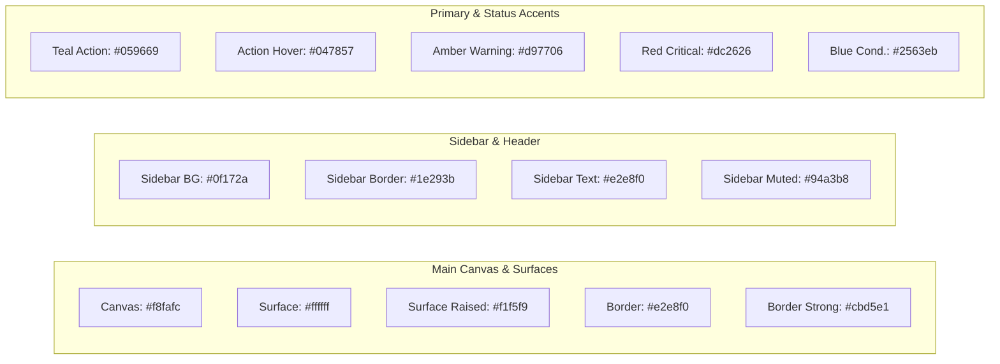
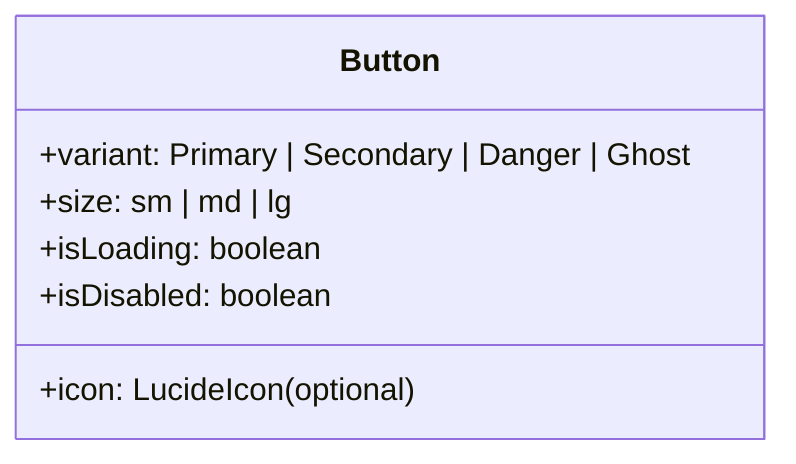

# PlantProof Design System & Interface Specification
**Document Version:** 1.0.0  
**Target:** Enterprise Multi-Tenant Manufacturing B2B SaaS  
**Accessibility Target:** WCAG 2.2 Level AA Compliant  
**Visual Reference:** [PlantProof UI Reference](file:///d:/Complaince%20System/docs/design/PlantProof_UI_Reference.png)

---

## 1. Visual Direction & Design Philosophy

PlantProof serves factory plant managers, environmental health & safety (EHS) heads, and industrial compliance auditors. The UI operates in high-stakes manufacturing environments where legal notices, inspection dates, and permit expiries require rapid, error-free comprehension.

### 1.1 Core Aesthetic Tenets
1. **Restrained Enterprise SaaS:** Light, neutral main canvas paired with a deep navy/slate sidebar for authoritative navigation. No trendy marketing gradients, neon glows, or distracting micro-animations.
2. **High Information Density with Generous Breathing Room:** Compact tabular data and clear visual hierarchy allow scanning 50+ obligations without scrolling fatigue.
3. **Semantic Status Clarity:** Never rely on color alone. Every badge, indicator, and checkmark combines an accessible icon, a high-contrast text label, and distinct tinting.
4. **Deliberate Accent Hierarchy:** Primary actions use a deep industrial teal/emerald (`#059669`). Warning amber (`#d97706`) and critical red (`#dc2626`) are reserved exclusively for near-term deadlines, missing documents, and overdue obligations.

---

## 2. Foundational Design Tokens

### 2.1 Color Tokens & Semantic Mappings



#### Detailed Color Variables
```css
:root {
  /* Canvas & Neutral Surfaces */
  --color-canvas-bg: #f8fafc;        /* Slate-50: Main app background */
  --color-surface: #ffffff;          /* White: Cards, tables, modals */
  --color-surface-subtle: #f1f5f9;   /* Slate-100: Table headers, hover rows */
  --color-surface-disabled: #e2e8f0; /* Slate-200: Disabled inputs */

  /* Sidebar Navigation (Dark Slate Navy) */
  --color-sidebar-bg: #0f172a;       /* Slate-900: Sidebar container */
  --color-sidebar-border: #1e293b;   /* Slate-800: Internal dividers */
  --color-sidebar-hover: #1e293b;    /* Slate-800: Nav item hover */
  --color-sidebar-text: #f8fafc;     /* Slate-50: Nav active labels */
  --color-sidebar-muted: #94a3b8;    /* Slate-400: Nav idle labels */

  /* Typography / Text Colors */
  --color-text-primary: #0f172a;     /* Slate-900: Headings, primary values */
  --color-text-secondary: #475569;   /* Slate-600: Descriptions, table subtext */
  --color-text-muted: #64748b;       /* Slate-500: Helper notes, timestamps */
  --color-text-inverse: #ffffff;     /* White: Text on primary buttons */

  /* Borders & Dividers */
  --color-border-subtle: #e2e8f0;    /* Slate-200: Card borders, dividers */
  --color-border-default: #cbd5e1;   /* Slate-300: Form field borders */
  --color-border-focus: #059669;     /* Emerald-600: Active input focus */

  /* Primary Brand Action (Industrial Teal / Emerald) */
  --color-primary-base: #059669;     /* Emerald-600 */
  --color-primary-hover: #047857;    /* Emerald-700 */
  --color-primary-active: #065f46;   /* Emerald-800 */
  --color-primary-tint: #ecfdf5;     /* Emerald-50: Badge backgrounds */
  --color-primary-border: #a7f3d0;   /* Emerald-200: Badge borders */

  /* Status Tokens (WCAG 2.2 AA Contrast Compliant: >= 4.5:1 on white/tint) */
  /* Valid / Compliant */
  --status-valid-text: #065f46;      /* Emerald-800 */
  --status-valid-bg: #ecfdf5;        /* Emerald-50 */
  --status-valid-border: #a7f3d0;    /* Emerald-200 */

  /* Warning / Due Soon / Pending Review */
  --status-warning-text: #92400e;    /* Amber-800 */
  --status-warning-bg: #fffbeb;      /* Amber-50 */
  --status-warning-border: #fde68a;  /* Amber-200 */

  /* Critical / Overdue / Missing / Rejected */
  --status-danger-text: #991b1b;     /* Red-800 */
  --status-danger-bg: #fef2f2;       /* Red-50 */
  --status-danger-border: #fecaca;   /* Red-200 */

  /* Info / Conditionally Applicable */
  --status-info-text: #1e40af;       /* Blue-800 */
  --status-info-bg: #eff6ff;         /* Blue-50 */
  --status-info-border: #bfdbfe;     /* Blue-200 */

  /* Neutral / Not Applicable / Exempted */
  --status-neutral-text: #334155;    /* Slate-700 */
  --status-neutral-bg: #f1f5f9;      /* Slate-100 */
  --status-neutral-border: #cbd5e1;  /* Slate-300 */

  /* Accessible Categorical Chart Palette */
  --chart-color-1: #059669; /* Compliant: Emerald */
  --chart-color-2: #d97706; /* Due Soon: Amber */
  --chart-color-3: #dc2626; /* Overdue: Red */
  --chart-color-4: #64748b; /* Not Applicable: Slate */
  --chart-color-5: #2563eb; /* Conditionally Applicable: Blue */
}
```

---

### 2.2 Typography Scale

The type scale uses standard system fonts (`Inter, -apple-system, BlinkMacSystemFont, 'Segoe UI', Roboto, sans-serif`) with explicit line-height and letter-spacing for legibility:

| Token | Size | Line Height | Weight | Tracking | Primary Usage |
| :--- | :---: | :---: | :---: | :---: | :--- |
| `text-display` | `28px (1.75rem)` | `36px` | `700 (Bold)` | `-0.02em` | Main page titles (Dashboard, Requirements Register) |
| `text-h1` | `22px (1.375rem)` | `28px` | `600 (Semibold)`| `-0.015em`| Section headers, Drawer titles, Card group headings |
| `text-h2` | `18px (1.125rem)` | `24px` | `600 (Semibold)`| `-0.01em` | Card headers, Modal titles, Inspector group titles |
| `text-subhead` | `15px (0.9375rem)`| `20px` | `600 (Semibold)`| `0` | Table column headers, Metric card sub-labels |
| `text-body` | `14px (0.875rem)` | `20px` | `400 (Regular)` | `0` | Standard body copy, form inputs, table cell data |
| `text-body-bold`| `14px (0.875rem)`| `20px` | `600 (Semibold)`| `0` | Emphasized row titles, primary values |
| `text-small` | `12px (0.75rem)` | `16px` | `500 (Medium)`  | `+0.01em`| Badges, status pills, helper captions, timestamps |
| `text-mono` | `13px (0.8125rem)`| `18px` | `500 (Medium)`  | `0` | Certificate numbers, notification numbers, dates |

---

### 2.3 Spacing Scale (4px Base Grid)

```css
--space-1: 4px;   /* Micro spacing: Badge padding, icon gap */
--space-2: 8px;   /* Tight spacing: Button inner gap, input padding */
--space-3: 12px;  /* Compact spacing: Form label gap, list padding */
--space-4: 16px;  /* Base spacing: Card padding, grid gutters */
--space-5: 20px;  /* Medium spacing: Section header separation */
--space-6: 24px;  /* Standard container padding: Main page margins */
--space-8: 32px;  /* Large gap: Major view divisions */
--space-10: 40px; /* Spacious separation */
--space-12: 48px; /* Page boundary padding */
```

---

### 2.4 Radii, Elevation & Focus Rings

```css
/* Corner Radii */
--radius-sm: 4px;     /* Small tags, inner icons */
--radius-md: 6px;     /* Inputs, dropdown buttons, action pills */
--radius-lg: 8px;     /* Standard cards, tables, modal containers */
--radius-xl: 12px;    /* Floating drawer panels, preview frames */
--radius-full: 9999px;/* Status pills, user avatar circles */

/* Elevation / Shadows (Restrained B2B, no heavy blurs) */
--shadow-xs: 0 1px 2px 0 rgba(15, 23, 42, 0.05);
--shadow-sm: 0 1px 3px 0 rgba(15, 23, 42, 0.08), 0 1px 2px -1px rgba(15, 23, 42, 0.05);
--shadow-md: 0 4px 6px -1px rgba(15, 23, 42, 0.08), 0 2px 4px -2px rgba(15, 23, 42, 0.04);
--shadow-lg: 0 10px 15px -3px rgba(15, 23, 42, 0.08), 0 4px 6px -4px rgba(15, 23, 42, 0.04);

/* Accessible Focus Ring (WCAG 2.2 compliant: 2px solid with 2px offset) */
--focus-ring: 0 0 0 2px #ffffff, 0 0 0 4px #059669;
```

---

## 3. Reusable UI Component Specifications

### 3.1 Buttons & Action Controls
Every button possesses distinct visual states: `idle`, `hover`, `active`, `focus-visible`, and `disabled`.



1. **Primary Button:**
   - Background: `--color-primary-base` (`#059669`), Text: `#ffffff`
   - Hover: `--color-primary-hover` (`#047857`)
   - Usage: Primary affirmative actions (`Approve Document`, `Mark as Reviewed`, `+ Add Custom Requirement`).
2. **Secondary / Outline Button:**
   - Background: `#ffffff`, Border: `1px solid var(--color-border-default)`, Text: `var(--color-text-primary)`
   - Hover: Background: `var(--color-surface-subtle)`
   - Usage: Filtering, Cancel, Export, Pagination controls.
3. **Destructive Button:**
   - Background: `var(--status-danger-bg)`, Border: `1px solid var(--status-danger-border)`, Text: `var(--status-danger-text)`
   - Hover: Background: `#fee2e2`
   - Usage: `Reject Document`, `Archive Rule`, `Remove Site`. Must trigger confirmation modal.

### 3.2 Accessible Status Pills & Badges
To comply with WCAG 2.2 AA, status pills must include an explicit semantic icon alongside the text label:

| Status State | Semantic Icon | Text Label | Foreground | Background | Border |
| :--- | :---: | :--- | :--- | :--- | :--- |
| **Valid** | `CheckCircle2` | `Valid` | `#065f46` | `#ecfdf5` | `#a7f3d0` |
| **Due Soon** | `Clock` | `Due Soon` | `#92400e` | `#fffbeb` | `#fde68a` |
| **Overdue** | `AlertTriangle`| `Overdue` | `#991b1b` | `#fef2f2` | `#fecaca` |
| **Missing** | `AlertCircle` | `Missing` | `#991b1b` | `#fef2f2` | `#fecaca` |
| **Conditionally Applicable** | `HelpCircle` | `Conditionally Applicable` | `#1e40af` | `#eff6ff` | `#bfdbfe` |
| **Not Required** | `MinusCircle` | `Not Required` | `#334155` | `#f1f5f9` | `#cbd5e1` |

### 3.3 Data Table Component Guidelines
- **Header Row:** Fixed on scroll; subtle grey background (`#f1f5f9`); uppercase text in `12px` semibold with sort chevron indicators.
- **Row Density:** Minimum row height `48px` to guarantee accessible touch and mouse targets.
- **Zebra & Hover:** Clean white rows with subtle hover highlight (`#f8fafc`).
- **Owner Column:** User avatar with 2-letter initials circle + full name in semibold + role in muted text.
- **Empty & Loading States:** Tables render built-in skeleton rows during API fetch and contextual empty state cards when no records match filter criteria.

---

## 4. Navigation Architecture

To keep navigation intuitive for non-technical factory personnel, navigation is split into a **Primary Operational Menu** and a dedicated **Admin Governance Menu**:

### 4.1 Primary Navigation (All Factory Roles)
1. **Dashboard (`/dashboard`):** Real-time readiness gauge, upcoming deadlines, urgent needs-attention queue.
2. **Requirements Register (`/requirements`):** Master inventory of statutory permits, consents, and licenses.
3. **Document Vault (`/documents`):** Repository of official certificates with extraction verification workflows.
4. **Regulatory Changes (`/regulatory-changes`):** Gazette amendments, impact proposals, and human sign-off.
5. **Tasks (`/tasks`):** Operational remediation and permit renewal checklist.
6. **Audits & Reports (`/reports`):** Traceable compliance dossiers and readiness certificate exports.
7. **Company Profile (`/company-profile`):** Physical plant operational parameters (capacities, chemicals, equipment).

### 4.2 Admin-Only Governance Menu (Requires `ADMIN` or `SUPER_ADMIN`)
8. **Master Data (`/admin/master-data`):** Jurisdictions, authorities, acts, and statutory requirement templates.
9. **Rule Review Bench (`/admin/rules`):** AST condition authoring, version comparison, and test bench.
10. **Users & Permissions (`/admin/users`):** Multi-tenant team roles and access control.
11. **System Audit Log (`/admin/audit-log`):** Tamper-evident transaction logs.

---

## 5. Global Asynchronous & Resilience States

Every interactive component and page must implement these standardized states:

1. **Skeleton Loading State:** Shimmering neutral placeholders mirroring the exact shape of headers, cards, and tables. No generic full-page spinner overlays.
2. **Actionable Empty State:** Displays a relevant muted icon (e.g., `FileSearch`), clear heading (e.g. *"No matching requirements found"*), a plain-language explanation, and a reset action button (*"Clear filters"*).
3. **Human-Friendly Error Banners:** Translates network and API errors into plain-language advice:
   - *Example:* *"Unable to load regulatory updates feed. Please verify your connection or click Retry."*
   - Strictly prohibits raw JSON payloads, unparsed HTTP exception traces, or SQL error strings.
4. **Destructive Confirmation Modals:** Document rejections, requirement exemptions, and rule deprecations require a confirmation dialog prompting for a mandatory audit justification before execution.
